# v2 detailed analysis: every output, read end to end

Generated 2026-10-16 from `v2_gridsearch/output/` (run 2026-10-16 14:32, commit 753c0b1) and the prediction cache. Figures are in `figures/`; every table is computed directly from the files named in each section.

## Contents
1. Run facts (cache, coverage, cost, truncation)
2. The answers as scored (component distributions, hedging, answer types)
3. Model × dataset scores under v1
4. The exhaustive grid
5. Honest selection and the plateau
6. Transfer: leave-one-dataset-out, leave-one-family-out, families
7. Sampled designs
8. Correctness on known-quality anchors
9. Leaderboards under every rule
10. Significance
11. Official-split comparability
12. Dataset diagnostics
13. What the data support, in one page

## 1. Run facts
Files: `data/predictions/*.jsonl`, `coverage.json`, `run_manifest.json`.
* 11 models × 31 datasets; 3,083 items kept per model (every model answered every kept item); models left out of the study: none.
| model | answers | cost_usd | in_tokens | out_tokens | out_p90 | latency_med | latency_p90 | reask_2500 | reask_8000 | reask_16000 | cut_at_16000 | cut_below_16000_pending | no_final_line | decoding |
|---|---|---|---|---|---|---|---|---|---|---|---|---|---|---|
| Gemini 3.8 Flash | 3083 | 3.36 | 605.52 | 262.26 | 632.80 | 1.28 | 3.22 | 168 | 18 | 0 | 0 | 0 | 11 | temperature=0.0 |
| Claude Opus 5 | 3083 | 95.95 | 799.42 | 255.06 | 376.80 | 2.16 | 5.62 | 144 | 38 | 13 | 0 | 0 | 0 | default (temperature rejected by API) |
| GPT-5.5 | 3083 | 19.00 | 538.10 | 173.61 | 294.80 | 1.88 | 4.47 | 150 | 3 | 0 | 0 | 0 | 268 | default (temperature rejected by API) |
| Claude Sonnet 5 | 3083 | 14.37 | 799.42 | 150.94 | 196.80 | 1.30 | 2.66 | 78 | 36 | 8 | 0 | 0 | 1 | default (temperature rejected by API) |
| Gemini 3.1 Pro | 3083 | 11.80 | 605.24 | 276.84 | 516.60 | 3.58 | 6.13 | 118 | 1 | 0 | 0 | 0 | 2 | temperature=0.0 |
| Grok 4 | 3083 | 8.33 | 715.88 | 36.95 | 75.00 | 3.27 | 7.80 | 0 | 0 | 0 | 0 | 0 | 1 | temperature=0.0 |
| DeepSeek-R1 | 3083 | 8.68 | 568.21 | 1143.25 | 3650.00 | 1.27 | 16.17 | 243 | 289 | 95 | 41 | 123 | 190 | temperature=0.0 |
| GPT-5.4-mini | 3083 | 4.04 | 538.10 | 128.62 | 274.60 | 0.87 | 2.14 | 127 | 4 | 0 | 0 | 0 | 382 | default (temperature rejected by API) |
| DeepSeek-chat | 3083 | 0.62 | 543.21 | 50.73 | 86.00 | 0.95 | 1.32 | 16 | 1 | 0 | 0 | 0 | 327 | temperature=0.0 |
| gpt-oss-120b | 3083 | 0.70 | 601.12 | 233.13 | 431.00 | 1.61 | 4.71 | 120 | 12 | 1 | 0 | 0 | 369 | temperature=0.0 |
| Llama 3.3 70B | 3083 | 1.77 | 568.45 | 82.25 | 183.00 | 1.40 | 4.49 | 16 | 0 | 0 | 0 | 0 | 20 | temperature=0.0 |

* Total cost USD 169 on the 31 study datasets; the most expensive model is Claude Opus 5 (USD 96, 57 % of the bill); the cheapest is DeepSeek-chat (USD 0.6).
* Output length varies 31× between models: DeepSeek-R1 averages 1143 output tokens, Grok 4 37. Reasoning models carry their thinking in the output budget, which is why they dominate the re-asks.
* Re-asks: 1180 answers were re-asked at 2,500 tokens, 402 at 8,000 and 117 at 16,000; 41 were still cut off at 16,000 (DeepSeek-R1 accounts for 41) and 123 unfinished answers below 16,000 are awaiting their next stage (DeepSeek-R1 accounts for 123: the 16,000-token re-ask failed on provider balance and their 8,000-token replies were kept). 1571 replies carry no literal `FINAL ANSWER` line; those are scored from a boxed expression or the last short line, which is why the extraction hand-check is still open.
Per dataset, the longest replies and most re-asks come from the document and SQL tasks:
| dataset | out_tokens | in_tokens | cut | reasked |
|---|---|---|---|---|
| officeqa | 1791 | 251 | 67 | 524 |
| officeqa_pro_v2 | 1441 | 2571 | 95 | 365 |
| bird | 863 | 557 | 28 | 267 |
| realhitbench | 288 | 1071 | 11 | 73 |
| tablebench | 255 | 707 | 7 | 57 |
| fintagging | 250 | 606 | 3 | 41 |
| mmtu | 200 | 533 | 4 | 46 |
| tableeval | 183 | 787 | 5 | 36 |
| hitab | 183 | 911 | 10 | 28 |
| smat | 178 | 580 | 1 | 33 |

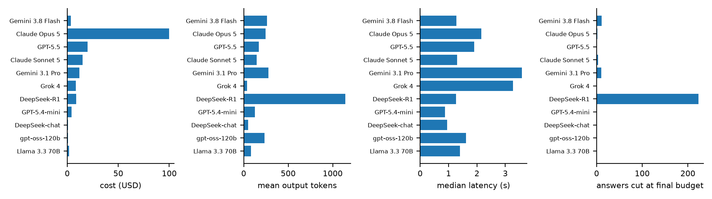

*Cost, output length, latency and residual cut-offs per model.*

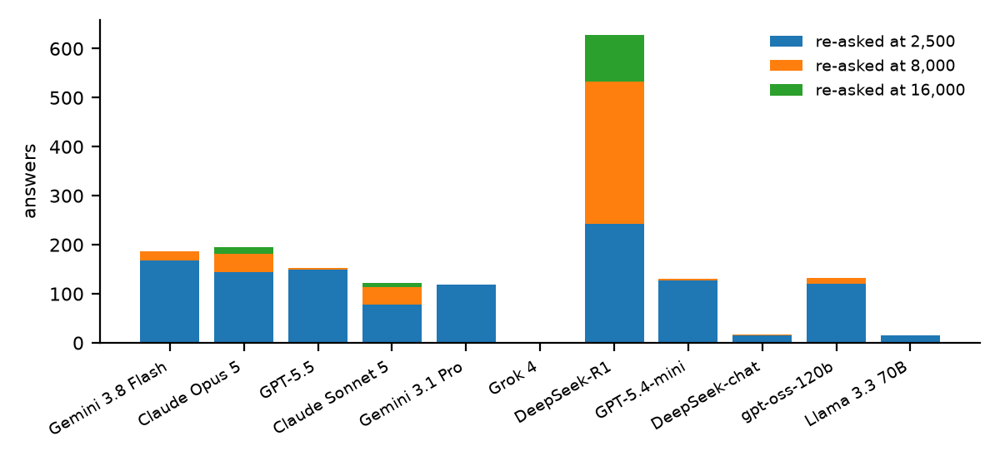

*Re-asks per model under the 700 → 2,500 → 8,000 protocol.*

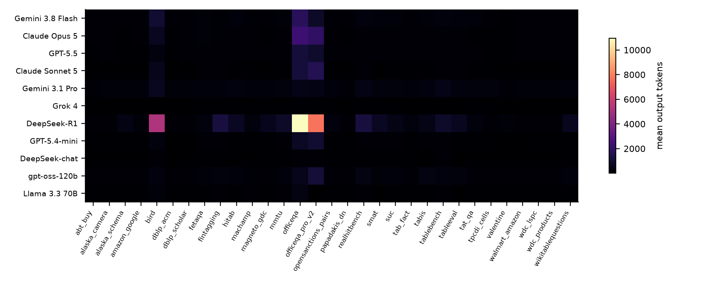

*Mean output tokens per model and dataset.*

## 2. The answers as scored
File: `components_v1.csv` (one row per model × item: native metric, exact match, numeric tolerance, F1, decay, precision, recall, hedge flag).
Mean of every ingredient by answer type (over all 30,830 scored answers):
| answer_type | items | answers | em | f1 | decay | precision | recall | v1 | hedged |
|---|---|---|---|---|---|---|---|---|---|
| boolean | 1238 | 13618 | 0.932 | 0.932 | 0.932 | 0.932 | 0.932 | 0.932 | 0.000 |
| freeform | 109 | 1199 | 0.009 | 0.567 | 0.009 | 0.649 | 0.593 | 0.388 | 0.000 |
| numeric | 632 | 6952 | 0.493 | 0.501 | 0.662 | 0.503 | 0.503 | 0.558 | 0.020 |
| text | 1104 | 12144 | 0.760 | 0.833 | 0.760 | 0.843 | 0.841 | 0.810 | 0.020 |

Reading: boolean and text golds are scored almost identically by every ingredient (F1 ≈ exact match), so the weights only matter on numeric and free-form golds. Numeric decay sits above exact match on numeric golds because near misses get partial credit; on free-form golds (FeTaQA) exact match and decay are ~0 while token overlap is ~0.6, so the composite is capped by the 0.65 of weight on F1 / precision / recall: any weight moved onto decay lowers every free-form score uniformly.
By family:
| family | answers | em | f1 | decay | precision | recall | v1 | native | hedged |
|---|---|---|---|---|---|---|---|---|---|
| EM | 12100 | 0.942 | 0.942 | 0.942 | 0.942 | 0.942 | 0.942 | 0.942 | 0.000 |
| FIN | 3190 | 0.272 | 0.314 | 0.459 | 0.313 | 0.323 | 0.366 | 0.312 | 0.052 |
| SM | 6523 | 0.799 | 0.867 | 0.811 | 0.883 | 0.869 | 0.850 | 0.799 | 0.006 |
| TQA | 12100 | 0.651 | 0.736 | 0.692 | 0.747 | 0.744 | 0.723 | 0.710 | 0.015 |

Spearman correlation between ingredients across all answers:
| index | em | num_tol | f1 | decay | precision | recall | native_value |
|---|---|---|---|---|---|---|---|
| em | 1.000 | 0.972 | 0.985 | 0.984 | 0.940 | 0.952 | 0.970 |
| num_tol | 0.972 | 1.000 | 0.955 | 0.978 | 0.915 | 0.923 | 0.993 |
| f1 | 0.985 | 0.955 | 1.000 | 0.961 | 0.967 | 0.977 | 0.960 |
| decay | 0.984 | 0.978 | 0.961 | 1.000 | 0.916 | 0.926 | 0.968 |
| precision | 0.940 | 0.915 | 0.967 | 0.916 | 1.000 | 0.938 | 0.918 |
| recall | 0.952 | 0.923 | 0.977 | 0.926 | 0.938 | 1.000 | 0.927 |
| native_value | 0.970 | 0.993 | 0.960 | 0.968 | 0.918 | 0.927 | 1.000 |

F1 and recall correlate 0.98, F1 and precision 0.97, decay and exact match 0.98: the four ingredients are far from independent, which is the first reason the weights barely matter.
* In 82.5 % of answers all four ingredients equal exact match (the answer is either exactly right or shares no token with the gold); any weighting gives the same score there. F1 equals exact match in 91.6 % of answers and decay equals it in 90.6 %.
Hedge rate per model (answers flagged as offering several candidates):
| model | hedge rate |
|---|---|
| Gemini 3.8 Flash | 0.006 |
| Claude Opus 5 | 0.005 |
| GPT-5.5 | 0.006 |
| Claude Sonnet 5 | 0.006 |
| Gemini 3.1 Pro | 0.013 |
| Grok 4 | 0.008 |
| DeepSeek-R1 | 0.045 |
| GPT-5.4-mini | 0.006 |
| DeepSeek-chat | 0.007 |
| gpt-oss-120b | 0.006 |
| Llama 3.3 70B | 0.021 |

Per dataset, the composite against the dataset's own metric (the largest gaps are where the weights can matter):
| dataset | native_metric | answer_type | native | v1 | em | v1 − native |
|---|---|---|---|---|---|---|
| fetaqa | rouge_l | freeform | 0.476 | 0.387 | 0.009 | -0.090 |
| mmtu | em | text | 0.885 | 0.873 | 0.845 | -0.011 |
| abt_buy | em | boolean | 0.971 | 0.971 | 0.971 | 0.000 |
| wdc_lspc | em | boolean | 0.982 | 0.982 | 0.982 | 0.000 |
| walmart_amazon | em | boolean | 0.959 | 0.959 | 0.959 | 0.000 |
| tabis | em | text | 0.918 | 0.918 | 0.918 | 0.000 |
| tab_fact | em | boolean | 0.802 | 0.802 | 0.802 | 0.000 |
| papadakis_dn | em | boolean | 0.940 | 0.940 | 0.940 | 0.000 |
| wdc_products | em | boolean | 0.978 | 0.978 | 0.978 | 0.000 |
| machamp | em | boolean | 0.887 | 0.887 | 0.887 | 0.000 |
| opensanctions_pairs | em | boolean | 0.835 | 0.835 | 0.835 | 0.000 |
| alaska_camera | em | boolean | 0.945 | 0.945 | 0.945 | 0.000 |
| dblp_scholar | em | boolean | 0.948 | 0.948 | 0.948 | 0.000 |
| dblp_acm | em | boolean | 0.987 | 0.987 | 0.987 | 0.000 |
| amazon_google | em | boolean | 0.935 | 0.935 | 0.935 | 0.000 |
| valentine | em | text | 0.981 | 0.985 | 0.981 | 0.005 |
| tablebench | num_tol | numeric | 0.806 | 0.822 | 0.767 | 0.016 |
| magneto_gdc | em | text | 0.911 | 0.937 | 0.911 | 0.026 |
| tableeval | num_tol | numeric | 0.728 | 0.755 | 0.707 | 0.027 |
| hitab | num_tol | numeric | 0.745 | 0.772 | 0.711 | 0.027 |
| suc | em | text | 0.890 | 0.917 | 0.889 | 0.027 |
| alaska_schema | em | text | 0.898 | 0.929 | 0.898 | 0.031 |
| realhitbench | num_tol | numeric | 0.635 | 0.675 | 0.589 | 0.041 |
| smat | em | text | 0.873 | 0.915 | 0.873 | 0.043 |
| wikitablequestions | em | numeric | 0.799 | 0.847 | 0.799 | 0.048 |
| tat_qa | em | numeric | 0.752 | 0.804 | 0.719 | 0.052 |
| officeqa | num_tol | numeric | 0.077 | 0.130 | 0.027 | 0.053 |
| officeqa_pro_v2 | num_tol | numeric | 0.084 | 0.142 | 0.046 | 0.058 |
| bird | em | numeric | 0.128 | 0.190 | 0.120 | 0.062 |
| fintagging | em | text | 0.797 | 0.883 | 0.797 | 0.086 |
| tpcdi_cells | num_tol | numeric | 0.344 | 0.456 | 0.344 | 0.113 |

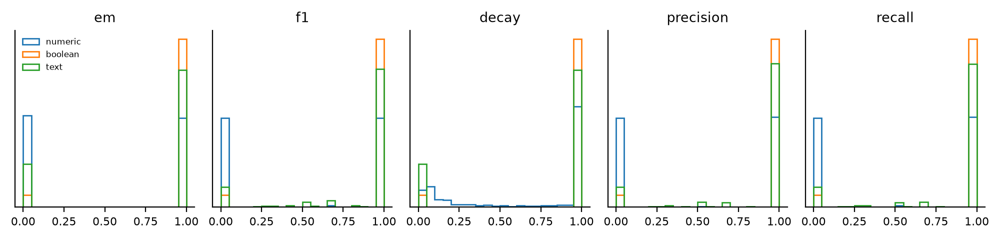

*Distribution of each ingredient by answer type.*

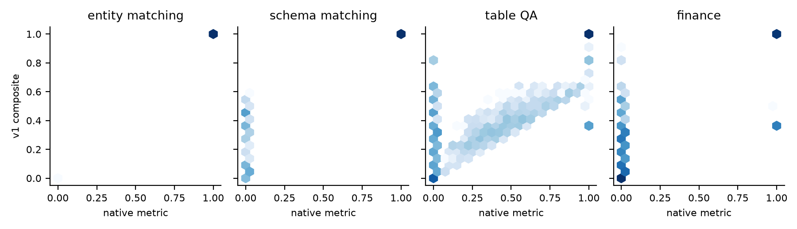

*Native metric vs v1 composite per answer, by family.*

## 3. Model × dataset scores under v1
Files: `leaderboards/v1_original/per_dataset_mean.csv`, `per_dataset_se.csv`.
| dataset | Gemini 3.8 Flash | Claude Opus 5 | GPT-5.5 | Claude Sonnet 5 | Gemini 3.1 Pro | Grok 4 | DeepSeek-R1 | GPT-5.4-mini | DeepSeek-chat | gpt-oss-120b | Llama 3.3 70B |
|---|---|---|---|---|---|---|---|---|---|---|---|
| abt_buy | 0.98 | 1.00 | 1.00 | 0.97 | 0.98 | 0.96 | 0.97 | 0.96 | 0.96 | 0.94 | 0.96 |
| alaska_camera | 0.89 | 0.82 | 1.00 | 0.98 | 0.81 | 0.94 | 0.99 | 0.97 | 1.00 | 1.00 | 0.99 |
| alaska_schema | 0.92 | 0.95 | 0.93 | 0.93 | 0.93 | 0.93 | 0.96 | 0.96 | 0.95 | 0.93 | 0.84 |
| amazon_google | 0.93 | 0.94 | 0.94 | 0.96 | 0.93 | 0.94 | 0.95 | 0.93 | 0.96 | 0.86 | 0.95 |
| bird | 0.29 | 0.29 | 0.19 | 0.23 | 0.18 | 0.12 | 0.21 | 0.18 | 0.19 | 0.08 | 0.12 |
| dblp_acm | 1.00 | 1.00 | 1.00 | 1.00 | 1.00 | 1.00 | 0.99 | 0.99 | 1.00 | 0.91 | 0.97 |
| dblp_scholar | 0.93 | 0.95 | 0.96 | 0.97 | 0.94 | 0.95 | 0.95 | 0.94 | 0.96 | 0.91 | 0.97 |
| fetaqa | 0.45 | 0.40 | 0.44 | 0.37 | 0.43 | 0.43 | 0.41 | 0.31 | 0.43 | 0.32 | 0.25 |
| fintagging | 0.90 | 0.91 | 0.89 | 0.90 | 0.89 | 0.89 | 0.87 | 0.89 | 0.86 | 0.86 | 0.86 |
| hitab | 0.75 | 0.78 | 0.76 | 0.76 | 0.78 | 0.75 | 0.78 | 0.78 | 0.81 | 0.75 | 0.78 |
| machamp | 0.90 | 0.90 | 0.90 | 0.90 | 0.89 | 0.89 | 0.90 | 0.89 | 0.89 | 0.83 | 0.87 |
| magneto_gdc | 0.96 | 0.97 | 0.97 | 0.95 | 0.96 | 0.94 | 0.98 | 0.91 | 0.95 | 0.96 | 0.75 |
| mmtu | 0.89 | 0.88 | 0.92 | 0.87 | 0.91 | 0.90 | 0.84 | 0.88 | 0.86 | 0.83 | 0.81 |
| officeqa | 0.19 | 0.20 | 0.17 | 0.17 | 0.12 | 0.13 | 0.09 | 0.11 | 0.08 | 0.08 | 0.10 |
| officeqa_pro_v2 | 0.20 | 0.27 | 0.19 | 0.15 | 0.12 | 0.12 | 0.05 | 0.12 | 0.12 | 0.10 | 0.11 |
| opensanctions_pairs | 0.86 | 0.94 | 0.75 | 0.73 | 0.97 | 0.85 | 0.85 | 0.90 | 0.76 | 0.78 | 0.79 |
| papadakis_dn | 0.94 | 0.92 | 0.95 | 0.95 | 0.93 | 0.95 | 0.94 | 0.95 | 0.94 | 0.93 | 0.94 |
| realhitbench | 0.75 | 0.74 | 0.72 | 0.68 | 0.70 | 0.64 | 0.66 | 0.66 | 0.66 | 0.60 | 0.61 |
| smat | 0.92 | 0.93 | 0.94 | 0.94 | 0.88 | 0.94 | 0.92 | 0.96 | 0.92 | 0.92 | 0.81 |
| suc | 0.98 | 0.99 | 0.94 | 0.91 | 0.94 | 0.94 | 0.94 | 0.91 | 0.86 | 0.93 | 0.74 |
| tab_fact | 0.86 | 0.66 | 0.84 | 0.74 | 0.83 | 0.85 | 0.77 | 0.82 | 0.84 | 0.83 | 0.78 |
| tabis | 0.95 | 0.96 | 0.96 | 0.92 | 0.95 | 0.98 | 0.97 | 0.90 | 0.77 | 0.92 | 0.82 |
| tablebench | 0.83 | 0.85 | 0.85 | 0.88 | 0.86 | 0.84 | 0.79 | 0.84 | 0.83 | 0.81 | 0.66 |
| tableeval | 0.79 | 0.77 | 0.78 | 0.73 | 0.79 | 0.80 | 0.77 | 0.74 | 0.71 | 0.77 | 0.64 |
| tat_qa | 0.83 | 0.86 | 0.79 | 0.84 | 0.80 | 0.79 | 0.81 | 0.79 | 0.81 | 0.77 | 0.75 |
| tpcdi_cells | 0.46 | 0.46 | 0.46 | 0.46 | 0.46 | 0.45 | 0.46 | 0.46 | 0.46 | 0.44 | 0.44 |
| valentine | 0.97 | 1.00 | 1.00 | 0.99 | 1.00 | 0.97 | 0.99 | 0.99 | 0.98 | 0.98 | 0.97 |
| walmart_amazon | 0.99 | 0.98 | 0.97 | 0.95 | 0.97 | 0.96 | 0.96 | 0.95 | 0.95 | 0.94 | 0.93 |
| wdc_lspc | 0.98 | 0.99 | 1.00 | 0.98 | 0.98 | 1.00 | 1.00 | 0.97 | 0.96 | 0.98 | 0.96 |
| wdc_products | 0.99 | 0.98 | 0.98 | 0.97 | 0.98 | 0.99 | 0.98 | 0.97 | 0.97 | 0.98 | 0.97 |
| wikitablequestions | 0.88 | 0.88 | 0.86 | 0.86 | 0.86 | 0.87 | 0.85 | 0.84 | 0.84 | 0.82 | 0.75 |

Standard error of each cell is the item-level SE of the mean (100 items):
| SE across cells | mean | min | max |
|---|---|---|---|
| mean | 0.025 | 0.002 | 0.043 |
| min | 0.023 | 0.000 | 0.042 |
| max | 0.028 | 0.010 | 0.047 |

Per-family mean composite per model:
| model | EM | FIN | SM | TQA |
|---|---|---|---|---|
| Gemini 3.8 Flash | 0.945 | 0.414 | 0.854 | 0.765 |
| Claude Opus 5 | 0.947 | 0.449 | 0.869 | 0.745 |
| GPT-5.5 | 0.950 | 0.388 | 0.864 | 0.751 |
| Claude Sonnet 5 | 0.942 | 0.398 | 0.862 | 0.724 |
| Gemini 3.1 Pro | 0.944 | 0.355 | 0.852 | 0.749 |
| Grok 4 | 0.948 | 0.354 | 0.851 | 0.738 |
| DeepSeek-R1 | 0.953 | 0.328 | 0.863 | 0.727 |
| GPT-5.4-mini | 0.947 | 0.347 | 0.859 | 0.716 |
| DeepSeek-chat | 0.941 | 0.342 | 0.852 | 0.711 |
| gpt-oss-120b | 0.915 | 0.324 | 0.848 | 0.698 |
| Llama 3.3 70B | 0.936 | 0.328 | 0.777 | 0.633 |

How each model's rank moves across datasets:
| model | mean score | mean rank | datasets ranked 1st | datasets in top 3 | datasets ranked last | best dataset | worst dataset |
|---|---|---|---|---|---|---|---|
| Gemini 3.8 Flash | 0.812 | 4.516 | 5 | 14 | 4 | dblp_acm | officeqa |
| Claude Opus 5 | 0.812 | 4.016 | 6 | 14 | 1 | abt_buy | officeqa |
| GPT-5.5 | 0.808 | 3.935 | 1 | 14 | 1 | abt_buy | officeqa |
| Claude Sonnet 5 | 0.796 | 5.435 | 1 | 10 | 1 | dblp_acm | officeqa_pro_v2 |
| Gemini 3.1 Pro | 0.799 | 5.629 | 1 | 6 | 1 | dblp_acm | officeqa |
| Grok 4 | 0.797 | 5.661 | 2 | 8 | 0 | dblp_acm | officeqa_pro_v2 |
| DeepSeek-R1 | 0.794 | 5.613 | 1 | 6 | 1 | wdc_lspc | officeqa_pro_v2 |
| GPT-5.4-mini | 0.789 | 6.839 | 2 | 5 | 2 | dblp_acm | officeqa |
| DeepSeek-chat | 0.784 | 6.710 | 1 | 5 | 2 | alaska_camera | officeqa |
| gpt-oss-120b | 0.767 | 8.565 | 0 | 1 | 7 | alaska_camera | officeqa |
| Llama 3.3 70B | 0.739 | 9.081 | 0 | 2 | 6 | alaska_camera | officeqa |

No model is first on more than 6 of 31 datasets, and even Llama 3.3 70B is not last everywhere (13 datasets). The leaderboard is an average over disagreeing datasets, which is what Kendall's W ≈ 0.27 says in section 10.
Datasets that separate the models most and least (max − min of the ten model means):
| most separating | spread | least separating | spread |
|---|---|---|---|
| suc | 0.246 | fintagging | 0.051 |
| opensanctions_pairs | 0.240 | wdc_lspc | 0.040 |
| magneto_gdc | 0.225 | valentine | 0.030 |
| officeqa_pro_v2 | 0.220 | papadakis_dn | 0.030 |
| tablebench | 0.218 | tpcdi_cells | 0.020 |
| tabis | 0.210 | wdc_products | 0.020 |

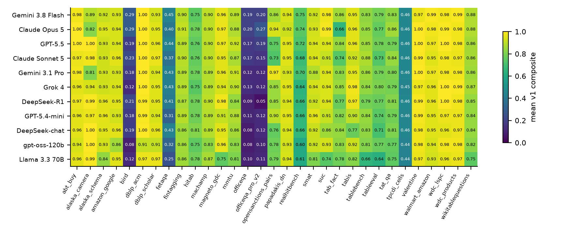

*Mean v1 score per model and dataset.*

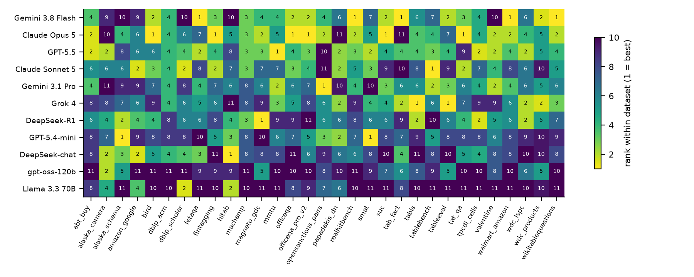

*Rank per model within each dataset.*

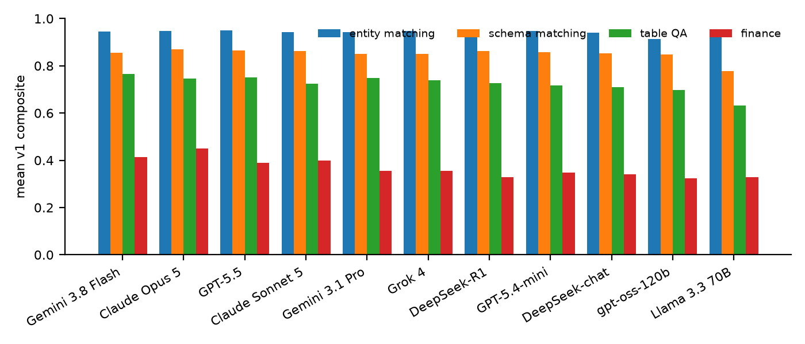

*Per-family means.*

## 4. The exhaustive grid
File: `grid_exhaustive.csv` (1,771 rows: the four weights, J under Borda / Kemeny / Copeland / Bradley–Terry pooling, τ to native metrics, min agreement, dispersion, per-dataset τ).
| 0.0 | 0.01 | 0.05 | 0.1 | 0.25 | 0.5 | 0.75 | 0.9 | 0.95 | 0.99 | 1.0 |
|---|---|---|---|---|---|---|---|---|---|---|
| 0.3764 | 0.3853 | 0.3899 | 0.3929 | 0.3972 | 0.4005 | 0.4047 | 0.4072 | 0.4092 | 0.4118 | 0.4143 |

* Range 0.3764–0.4143; interquartile range 0.0075; standard deviation 0.0058. The bootstrap SD of J for a single weighting (section 5) is about 0.026, i.e. larger than the spread of the whole grid.
Named points and the ten best:
| rank | label | weights | J | J_kemeny | J_copeland | J_bt | tau_native | min_agree | dispersion |
|---|---|---|---|---|---|---|---|---|---|
| 1 |  | F1 0.35 / decay 0.60 / P 0.05 / R 0.00 | 0.414 | 0.413 | 0.413 | 0.403 | 0.922 | -0.343 | 1.701 |
| 2 |  | F1 0.80 / decay 0.00 / P 0.20 / R 0.00 | 0.414 | 0.414 | 0.414 | 0.383 | 0.877 | -0.397 | 1.816 |
| 3 |  | F1 0.85 / decay 0.00 / P 0.15 / R 0.00 | 0.414 | 0.414 | 0.414 | 0.383 | 0.877 | -0.397 | 1.820 |
| 4 |  | F1 0.20 / decay 0.00 / P 0.50 / R 0.30 | 0.414 | 0.411 | 0.415 | 0.380 | 0.876 | -0.343 | 1.843 |
| 5 |  | F1 0.00 / decay 0.15 / P 0.15 / R 0.70 | 0.413 | 0.413 | 0.413 | 0.395 | 0.881 | -0.272 | 1.885 |
| 6 |  | F1 0.05 / decay 0.15 / P 0.10 / R 0.70 | 0.413 | 0.413 | 0.413 | 0.395 | 0.881 | -0.272 | 1.897 |
| 7 |  | F1 0.15 / decay 0.15 / P 0.05 / R 0.65 | 0.413 | 0.413 | 0.413 | 0.395 | 0.881 | -0.272 | 1.893 |
| 8 |  | F1 0.20 / decay 0.15 / P 0.00 / R 0.65 | 0.413 | 0.413 | 0.413 | 0.395 | 0.881 | -0.272 | 1.906 |
| 9 |  | F1 0.25 / decay 0.15 / P 0.00 / R 0.60 | 0.413 | 0.413 | 0.413 | 0.395 | 0.881 | -0.272 | 1.891 |
| 10 |  | F1 0.05 / decay 0.10 / P 0.15 / R 0.70 | 0.413 | 0.411 | 0.411 | 0.394 | 0.874 | -0.272 | 1.912 |
| 96 | only_f1 | F1 1.00 / decay 0.00 / P 0.00 / R 0.00 | 0.409 | 0.407 | 0.407 | 0.378 | 0.881 | -0.343 | 1.837 |
| 806 | uniform | F1 0.25 / decay 0.25 / P 0.25 / R 0.25 | 0.401 | 0.414 | 0.414 | 0.396 | 0.897 | -0.208 | 1.742 |
| 1513 | only_decay | F1 0.00 / decay 1.00 / P 0.00 / R 0.00 | 0.394 | 0.400 | 0.408 | 0.369 | 0.910 | -0.245 | 1.794 |
| 1602 | v1_original | F1 0.35 / decay 0.35 / P 0.15 / R 0.15 | 0.392 | 0.402 | 0.402 | 0.390 | 0.910 | -0.273 | 1.715 |
| 1703 | only_recall | F1 0.00 / decay 0.00 / P 0.00 / R 1.00 | 0.389 | 0.389 | 0.399 | 0.357 | 0.826 | -0.426 | 2.144 |
| 1744 | only_precision | F1 0.00 / decay 0.00 / P 1.00 / R 0.00 | 0.386 | 0.386 | 0.390 | 0.340 | 0.845 | -0.359 | 1.987 |

Rank of v1 under each pooling rule (of 1,771):
| pooling | v1 J | best J | v1 rank | best weighting |
|---|---|---|---|---|
| Borda | 0.392 | 0.414 | 1602 | F1 0.35 / decay 0.60 / P 0.05 / R 0.00 |
| Kemeny | 0.402 | 0.418 | 1404 | F1 0.35 / decay 0.20 / P 0.05 / R 0.40 |
| Copeland | 0.402 | 0.421 | 1542 | F1 0.05 / decay 0.60 / P 0.25 / R 0.10 |
| Bradley–Terry | 0.390 | 0.404 | 615 | F1 0.25 / decay 0.60 / P 0.10 / R 0.05 |

Marginal effect of each weight (mean and max J at each weight level, step 0.05):
**F1**: mean J over weightings with this weight fixed is lowest at weight 0.00 (0.3977) and highest at weight 1.00 (0.4090); at weight 0 it is 0.3977 and at weight 1 it is 0.4090; whole-range swing 0.0112.

**decay**: mean J over weightings with this weight fixed is lowest at weight 0.40 (0.3935) and highest at weight 0.15 (0.4062); at weight 0 it is 0.4013 and at weight 1 it is 0.3943; whole-range swing 0.0127.

**precision**: mean J over weightings with this weight fixed is lowest at weight 0.95 (0.3842) and highest at weight 0.35 (0.4013); at weight 0 it is 0.4010 and at weight 1 it is 0.3863; whole-range swing 0.0170.

**recall**: mean J over weightings with this weight fixed is lowest at weight 1.00 (0.3888) and highest at weight 0.55 (0.4034); at weight 0 it is 0.3986 and at weight 1 it is 0.3888; whole-range swing 0.0146.

Spearman correlation of J with each weight across the grid: F1 +0.28, decay -0.24, precision -0.08, recall +0.10. Recall and decay help a little, precision and F1 hurt a little; none of the effects exceeds 0.02 of J.
τ to native metrics: v1 0.910, best 0.922, grid range 0.826–0.932; correlation between J and τ-native across the grid -0.12.
Per-dataset agreement with the pooled ranking (the objective is the mean of the first τ column):
| dataset | family | τ under v1 | τ under best | max τ over grid | min τ over grid |
|---|---|---|---|---|---|
| hitab | TQA | -0.273 | -0.330 | 0.018 | -0.382 |
| alaska_camera | EM | -0.245 | -0.343 | -0.208 | -0.397 |
| alaska_schema | SM | -0.091 | -0.073 | 0.091 | -0.426 |
| tab_fact | TQA | -0.019 | 0.037 | 0.130 | -0.093 |
| opensanctions_pairs | EM | 0.037 | 0.093 | 0.220 | 0.000 |
| papadakis_dn | EM | 0.042 | 0.105 | 0.166 | -0.126 |
| dblp_scholar | EM | 0.096 | 0.039 | 0.135 | -0.096 |
| amazon_google | EM | 0.098 | 0.000 | 0.138 | -0.059 |
| tableeval | TQA | 0.236 | 0.330 | 0.382 | 0.200 |
| wdc_products | EM | 0.306 | 0.375 | 0.525 | 0.306 |
| smat | SM | 0.382 | 0.440 | 0.491 | 0.164 |
| tabis | TQA | 0.411 | 0.472 | 0.598 | 0.374 |
| fetaqa | TQA | 0.418 | 0.514 | 0.600 | -0.164 |
| tablebench | TQA | 0.455 | 0.514 | 0.564 | 0.294 |
| valentine | SM | 0.472 | 0.534 | 0.585 | 0.321 |
| officeqa_pro_v2 | FIN | 0.491 | 0.550 | 0.807 | 0.382 |
| wdc_lspc | EM | 0.503 | 0.527 | 0.629 | 0.422 |
| suc | TQA | 0.514 | 0.648 | 0.698 | 0.477 |
| fintagging | SM | 0.527 | 0.697 | 0.725 | 0.418 |
| mmtu | TQA | 0.527 | 0.624 | 0.636 | 0.382 |
| officeqa | FIN | 0.564 | 0.697 | 0.745 | 0.449 |
| magneto_gdc | SM | 0.564 | 0.477 | 0.709 | 0.455 |
| dblp_acm | EM | 0.587 | 0.640 | 0.687 | 0.493 |
| tat_qa | FIN | 0.600 | 0.587 | 0.697 | 0.127 |
| realhitbench | TQA | 0.636 | 0.697 | 0.807 | 0.564 |
| tpcdi_cells | SM | 0.662 | 0.530 | 0.740 | 0.452 |
| bird | TQA | 0.673 | 0.404 | 0.745 | 0.382 |
| walmart_amazon | EM | 0.686 | 0.712 | 0.877 | 0.648 |
| wikitablequestions | TQA | 0.709 | 0.844 | 0.844 | 0.587 |
| abt_buy | EM | 0.795 | 0.783 | 0.883 | 0.702 |
| machamp | EM | 0.799 | 0.719 | 0.814 | 0.669 |

4 datasets have negative τ under v1 (hitab, alaska_camera, alaska_schema, tab_fact): their model ranking runs against the consensus whatever the weights, and no weighting flips them (their maximum over the grid is +0.13). Alaska Camera is stably against the consensus (self-stability 0.92: Claude Opus 5 scores 0.82 there while every other model is above 0.81), while HiTab and Alaska schema are among the least self-stable sets (0.57 and 0.68), so their disagreement is partly noise.

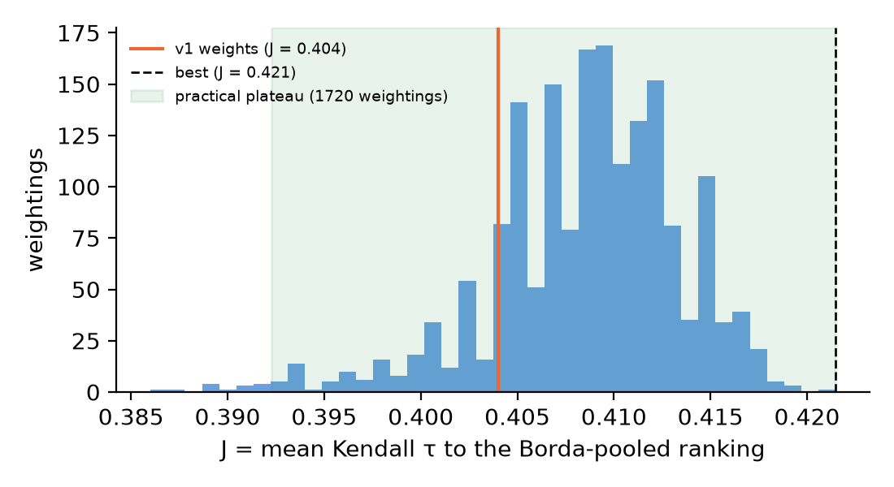

*Distribution of J over the grid.*

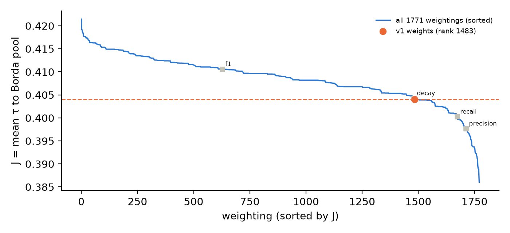

*Sorted J with v1 and corners.*

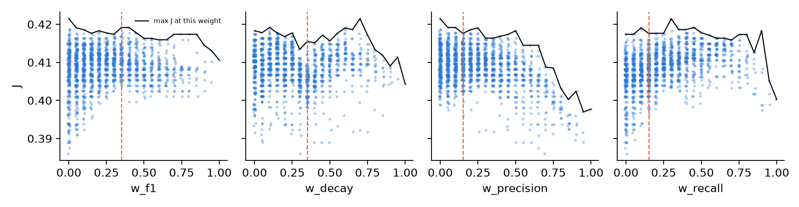

*J against each weight.*

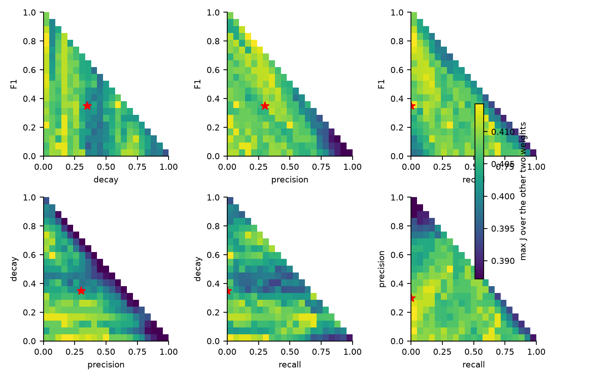

*Best J for each pair of weights.*

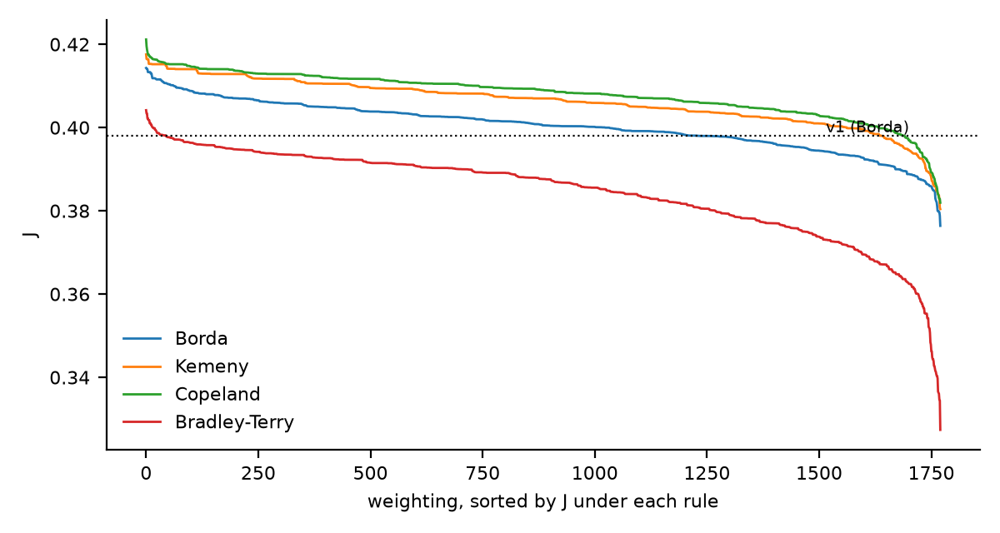

*J under four pooling rules.*

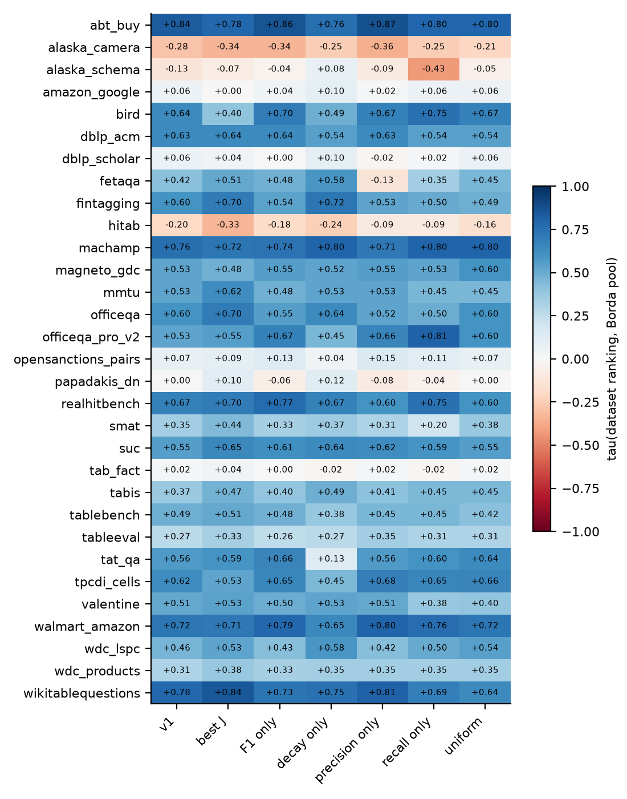

*Per-dataset τ under named weightings.*

## 5. Honest selection and the plateau
Files: `selection/nested.json`, `nested_draws.npz` (1,000 × 1,771 in-bag and out-of-bag J), `plateau.csv`, `sensitivity.json`.
| quantity | mean | sd | 2.5 % | 97.5 % |
|---|---|---|---|---|
| in-bag J of selected | 0.370 | 0.025 | 0.322 | 0.420 |
| out-of-bag J of selected | 0.323 | 0.032 | 0.259 | 0.381 |
| out-of-bag J of v1 | 0.330 | 0.032 | 0.265 | 0.389 |
| out-of-bag J of full-data best | 0.328 | 0.032 | 0.263 | 0.389 |
| selected − v1 (out of bag) | -0.007 | 0.011 | -0.033 | 0.011 |
| full-data best − v1 (out of bag) | -0.003 | 0.008 | -0.018 | 0.013 |

* Optimism gap 0.047: the in-bag winner looks 0.047 better than it is. Out of bag it is -0.007 from v1 and ahead of v1 in 28 % of resamples; the full-data best is ahead of v1 in 36 %.
* 624 distinct weightings were selected across 1,000 resamples. Mean selected weights f1 0.30, decay 0.28, precision 0.16, recall 0.27 with SDs f1 0.26, decay 0.22, precision 0.16, recall 0.25: the selection is essentially uniform over the simplex.
Most often selected weightings (times selected of 1,000):
| weights | J_full | J_boot_mean | J_boot_sd | J_oob_mean | times_selected | p_vs_best |
|---|---|---|---|---|---|---|
| F1 0.00 / decay 0.70 / P 0.00 / R 0.30 | 0.409 | 0.350 | 0.026 | 0.325 | 10 | 0.368 |
| F1 0.00 / decay 0.35 / P 0.00 / R 0.65 | 0.399 | 0.356 | 0.026 | 0.330 | 9 | 0.627 |
| F1 0.05 / decay 0.40 / P 0.00 / R 0.55 | 0.400 | 0.355 | 0.026 | 0.329 | 6 | 0.607 |
| F1 0.00 / decay 0.55 / P 0.00 / R 0.45 | 0.402 | 0.353 | 0.026 | 0.328 | 6 | 0.542 |
| F1 0.00 / decay 0.40 / P 0.00 / R 0.60 | 0.398 | 0.355 | 0.026 | 0.329 | 6 | 0.623 |
| F1 0.00 / decay 0.25 / P 0.00 / R 0.75 | 0.398 | 0.355 | 0.026 | 0.328 | 6 | 0.584 |
| F1 0.00 / decay 0.20 / P 0.00 / R 0.80 | 0.404 | 0.354 | 0.026 | 0.327 | 6 | 0.550 |
| F1 0.80 / decay 0.00 / P 0.20 / R 0.00 | 0.414 | 0.352 | 0.026 | 0.324 | 6 | 0.485 |
| F1 0.00 / decay 0.15 / P 0.10 / R 0.75 | 0.407 | 0.354 | 0.026 | 0.326 | 5 | 0.541 |
| F1 0.00 / decay 0.65 / P 0.00 / R 0.35 | 0.411 | 0.352 | 0.026 | 0.326 | 5 | 0.445 |
| F1 0.75 / decay 0.00 / P 0.20 / R 0.05 | 0.412 | 0.352 | 0.026 | 0.323 | 5 | 0.487 |
| F1 0.45 / decay 0.45 / P 0.10 / R 0.00 | 0.399 | 0.355 | 0.026 | 0.330 | 5 | 0.672 |

* Plateau: 1749 of 1,771 weightings are not significantly below the best (paired bootstrap p > .05); v1 is inside with p = 0.63. The 22 outside are: F1 0.00 / decay 0.95 / P 0.05 / R 0.00; F1 0.00 / decay 0.60 / P 0.35 / R 0.05; F1 0.05 / decay 0.75 / P 0.20 / R 0.00; F1 0.05 / decay 0.65 / P 0.30 / R 0.00; F1 0.00 / decay 0.55 / P 0.40 / R 0.05; F1 0.00 / decay 0.65 / P 0.30 / R 0.05; F1 0.05 / decay 0.60 / P 0.35 / R 0.00; F1 0.05 / decay 0.55 / P 0.40 / R 0.00; F1 0.00 / decay 0.90 / P 0.10 / R 0.00; F1 0.05 / decay 0.70 / P 0.25 / R 0.00; F1 0.00 / decay 0.80 / P 0.20 / R 0.00; F1 0.00 / decay 0.05 / P 0.95 / R 0.00; F1 0.00 / decay 0.40 / P 0.60 / R 0.00; F1 0.00 / decay 0.60 / P 0.40 / R 0.00; F1 0.00 / decay 0.85 / P 0.15 / R 0.00; F1 0.00 / decay 0.65 / P 0.35 / R 0.00; F1 0.00 / decay 0.55 / P 0.45 / R 0.00; F1 0.00 / decay 0.75 / P 0.25 / R 0.00; F1 0.00 / decay 0.45 / P 0.55 / R 0.00; F1 0.00 / decay 0.35 / P 0.65 / R 0.00; F1 0.00 / decay 0.70 / P 0.30 / R 0.00; F1 0.00 / decay 0.50 / P 0.50 / R 0.00.
* Practical plateau (bootstrap mean within 0.02 of the best): 1731; weight ranges inside it: f1 [0.00, 1.00], decay [0.00, 1.00], precision [0.00, 0.85], recall [0.00, 0.95]. Every weight can take almost any value and stay within 0.02 of the best.
* v1 is in the top 5 % of in-bag J in 6 % of resamples.
Sensitivity to one lattice step (0.05):
| point | n_neighbours | J_centre | J_min | J_max | J_mean | flatness_range | share_neighbours_better |
|---|---|---|---|---|---|---|---|
| v1 | 12.0000 | 0.3923 | 0.3876 | 0.3999 | 0.3945 | 0.0122 | 0.7692 |
| best | 9.0000 | 0.4143 | 0.3977 | 0.4143 | 0.4057 | 0.0166 | 0.0000 |

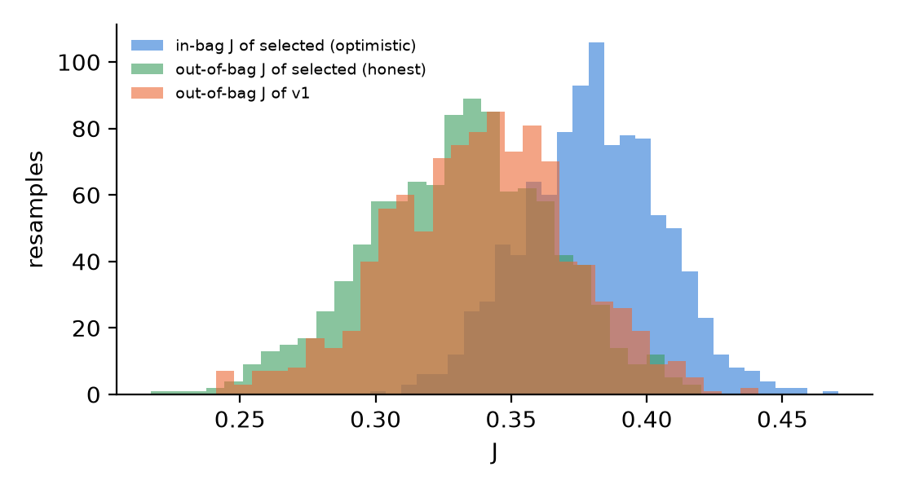

*In-bag vs out-of-bag J.*

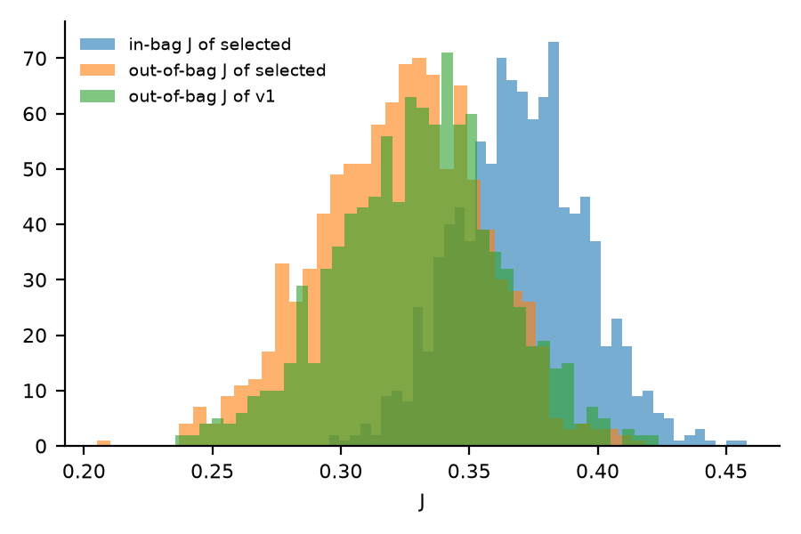

*Distributions behind the optimism gap.*

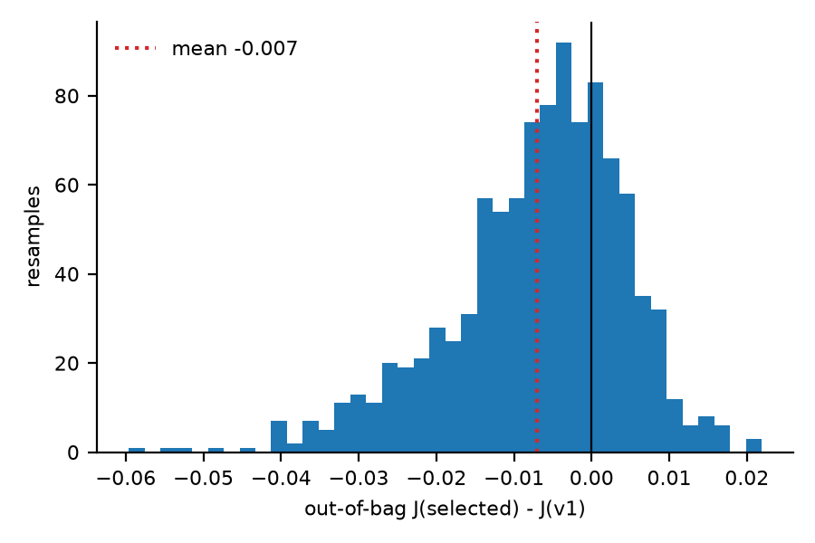

*Out-of-bag difference to v1.*

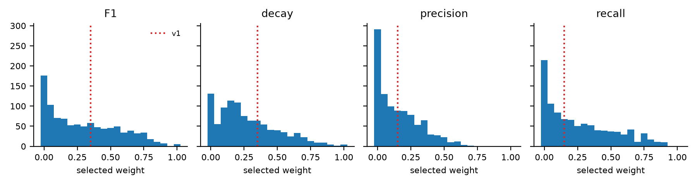

*Selected weights across resamples.*

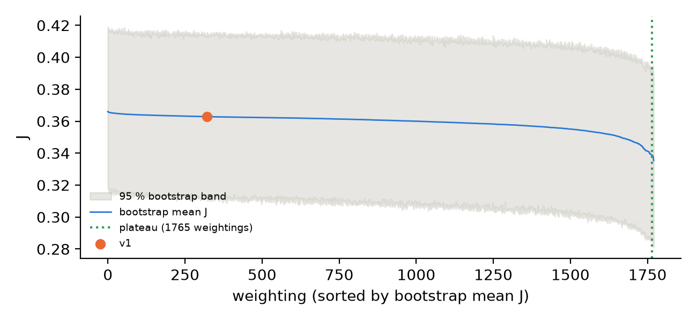

*Bootstrap band and plateau boundary.*

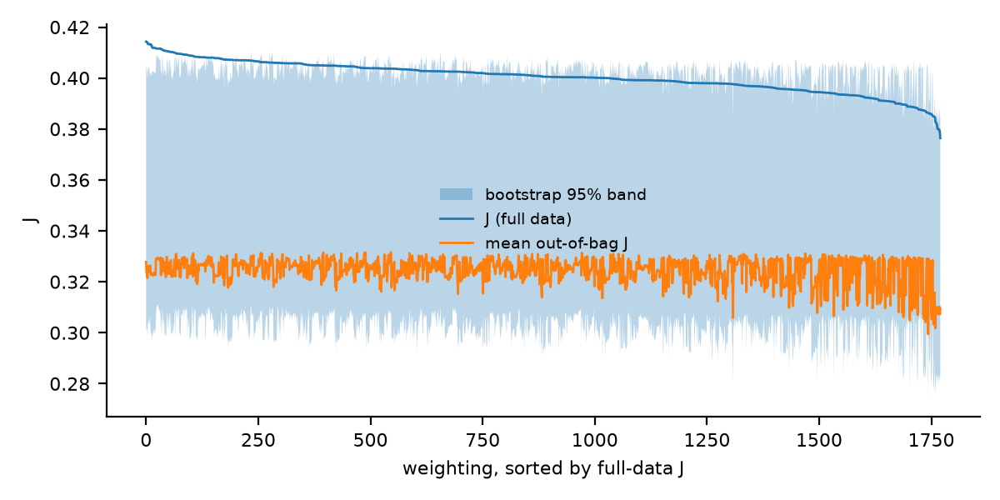

*Full-data, bootstrap and out-of-bag J in rank order.*

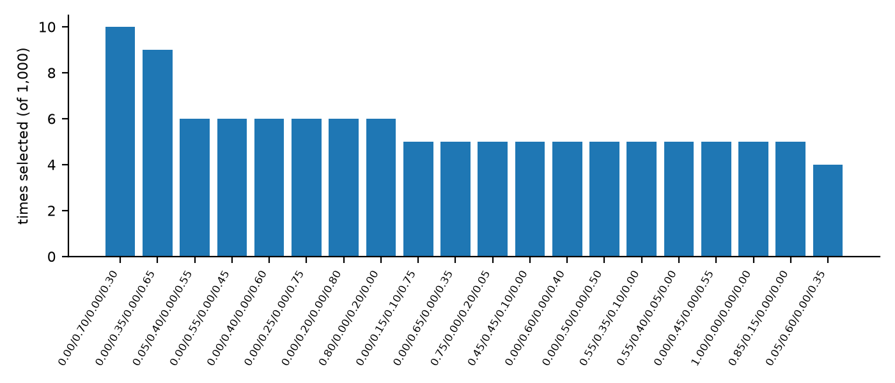

*Most selected weightings.*

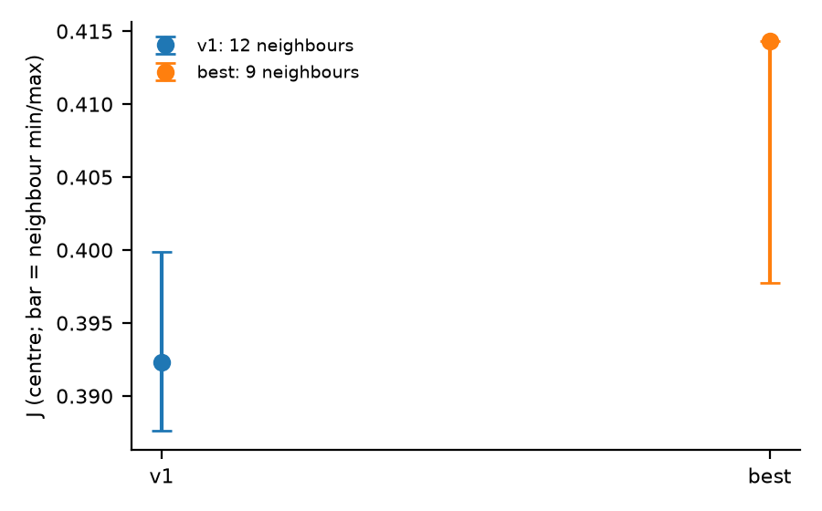

*One-step sensitivity.*

## 6. Transfer
Files: `selection/lodo.csv`, `lofo.csv`, `per_family.json`.
Leave-one-dataset-out: τ of the held-out dataset's ranking to the pooled ranking of the other 30, under weights re-fitted without it, the full-data best and v1:
| held_out | lodo_weights | full_best | v1 | family | refitted weights |
|---|---|---|---|---|---|
| alaska_camera | -0.380 | -0.397 | -0.397 | EM | F1 0.00 / decay 0.55 / P 0.10 / R 0.35 |
| hitab | -0.337 | -0.345 | -0.382 | TQA | F1 0.45 / decay 0.20 / P 0.20 / R 0.15 |
| alaska_schema | -0.183 | -0.091 | -0.164 | SM | F1 0.45 / decay 0.25 / P 0.20 / R 0.10 |
| papadakis_dn | -0.105 | -0.021 | -0.083 | EM | F1 0.50 / decay 0.00 / P 0.35 / R 0.15 |
| amazon_google | 0.000 | -0.059 | -0.059 | EM | F1 0.55 / decay 0.00 / P 0.30 / R 0.15 |
| tab_fact | -0.037 | -0.093 | -0.056 | TQA | F1 0.30 / decay 0.00 / P 0.45 / R 0.25 |
| dblp_scholar | -0.020 | 0.000 | -0.039 | EM | F1 0.05 / decay 0.55 / P 0.30 / R 0.10 |
| opensanctions_pairs | 0.037 | 0.037 | 0.000 | EM | F1 0.35 / decay 0.60 / P 0.05 / R 0.00 |
| tableeval | 0.294 | 0.236 | 0.200 | TQA | F1 0.20 / decay 0.00 / P 0.50 / R 0.30 |
| smat | 0.164 | 0.367 | 0.273 | SM | F1 0.25 / decay 0.15 / P 0.05 / R 0.55 |
| wdc_products | 0.306 | 0.306 | 0.306 | EM | F1 0.80 / decay 0.00 / P 0.20 / R 0.00 |
| fetaqa | 0.411 | 0.382 | 0.330 | TQA | F1 0.00 / decay 0.15 / P 0.00 / R 0.85 |
| tabis | 0.442 | 0.411 | 0.374 | TQA | F1 0.00 / decay 0.05 / P 0.50 / R 0.45 |
| tablebench | 0.440 | 0.382 | 0.382 | TQA | F1 0.80 / decay 0.00 / P 0.20 / R 0.00 |
| valentine | 0.419 | 0.472 | 0.397 | SM | F1 0.00 / decay 0.05 / P 0.50 / R 0.45 |
| officeqa_pro_v2 | 0.449 | 0.455 | 0.440 | FIN | F1 0.00 / decay 0.60 / P 0.00 / R 0.40 |
| magneto_gdc | 0.486 | 0.455 | 0.455 | SM | F1 0.00 / decay 0.25 / P 0.20 / R 0.55 |
| wdc_lspc | 0.475 | 0.503 | 0.462 | EM | F1 0.05 / decay 0.15 / P 0.35 / R 0.45 |
| mmtu | 0.404 | 0.527 | 0.477 | TQA | F1 0.25 / decay 0.10 / P 0.15 / R 0.50 |
| suc | 0.598 | 0.550 | 0.477 | TQA | F1 0.10 / decay 0.75 / P 0.00 / R 0.15 |
| fintagging | 0.440 | 0.600 | 0.491 | SM | F1 0.20 / decay 0.25 / P 0.30 / R 0.25 |
| tpcdi_cells | 0.540 | 0.506 | 0.506 | SM | F1 0.50 / decay 0.10 / P 0.00 / R 0.40 |
| tat_qa | 0.367 | 0.564 | 0.514 | FIN | F1 0.20 / decay 0.75 / P 0.05 / R 0.00 |
| officeqa | 0.510 | 0.600 | 0.527 | FIN | F1 0.50 / decay 0.00 / P 0.35 / R 0.15 |
| dblp_acm | 0.555 | 0.545 | 0.540 | EM | F1 0.00 / decay 0.15 / P 0.15 / R 0.70 |
| bird | 0.367 | 0.367 | 0.564 | TQA | F1 0.35 / decay 0.60 / P 0.05 / R 0.00 |
| realhitbench | 0.636 | 0.636 | 0.600 | TQA | F1 0.60 / decay 0.20 / P 0.20 / R 0.00 |
| walmart_amazon | 0.726 | 0.648 | 0.648 | EM | F1 0.25 / decay 0.15 / P 0.05 / R 0.55 |
| wikitablequestions | 0.709 | 0.745 | 0.709 | TQA | F1 0.80 / decay 0.00 / P 0.20 / R 0.00 |
| machamp | 0.669 | 0.719 | 0.713 | EM | F1 0.80 / decay 0.00 / P 0.20 / R 0.00 |
| abt_buy | 0.859 | 0.716 | 0.716 | EM | F1 0.20 / decay 0.00 / P 0.50 / R 0.30 |

* Means: re-fitted +0.330, full best +0.346, v1 +0.320. Re-fitting beats v1 on 20 datasets and loses on 9; the re-fitted weights are different for almost every held-out set, which is the plateau seen from another side.
* Hardest to predict (τ ≤ 0 under every rule): alaska_camera, alaska_schema, amazon_google, dblp_scholar, hitab, papadakis_dn, tab_fact. Easiest (τ ≥ 0.7): abt_buy, wikitablequestions.
Leave-one-family-out:
| held_out | weights_from | weights | J_rest | tau_heldout_mean | n_heldout |
|---|---|---|---|---|---|
| EM | lodo_weights | F1 0.70 / decay 0.15 / P 0.05 / R 0.10 | 0.471 | 0.320 | 11 |
| EM | full_best | F1 0.35 / decay 0.60 / P 0.05 / R 0.00 | 0.465 | 0.312 | 11 |
| EM | v1 | F1 0.35 / decay 0.35 / P 0.15 / R 0.15 | 0.453 | 0.316 | 11 |
| SM | lodo_weights | F1 0.05 / decay 0.25 / P 0.00 / R 0.70 | 0.420 | 0.329 | 6 |
| SM | full_best | F1 0.35 / decay 0.60 / P 0.05 / R 0.00 | 0.407 | 0.304 | 6 |
| SM | v1 | F1 0.35 / decay 0.35 / P 0.15 / R 0.15 | 0.399 | 0.280 | 6 |
| TQA | lodo_weights | F1 0.05 / decay 0.00 / P 0.60 / R 0.35 | 0.421 | 0.335 | 11 |
| TQA | full_best | F1 0.35 / decay 0.60 / P 0.05 / R 0.00 | 0.419 | 0.367 | 11 |
| TQA | v1 | F1 0.35 / decay 0.35 / P 0.15 / R 0.15 | 0.405 | 0.330 | 11 |
| FIN | lodo_weights | F1 0.05 / decay 0.75 / P 0.05 / R 0.15 | 0.400 | 0.449 | 3 |
| FIN | full_best | F1 0.35 / decay 0.60 / P 0.05 / R 0.00 | 0.391 | 0.489 | 3 |
| FIN | v1 | F1 0.35 / decay 0.35 / P 0.15 / R 0.15 | 0.381 | 0.440 | 3 |

Per-family optimum and the family's J under its own optimum, the global best and v1:
| family | datasets | best weights | J own | J global best | J v1 | L1 to global |
|---|---|---|---|---|---|---|
| EM | 11 | F1 0.35 / decay 0.60 / P 0.05 / R 0.00 | 0.358 | 0.358 | 0.358 | 0.000 |
| SM | 6 | F1 0.00 / decay 1.00 / P 0.00 / R 0.00 | 0.556 | 0.535 | 0.512 | 0.800 |
| TQA | 11 | F1 0.05 / decay 0.05 / P 0.25 / R 0.65 | 0.484 | 0.470 | 0.463 | 1.700 |
| FIN | 3 | F1 0.00 / decay 0.05 / P 0.00 / R 0.95 | 0.842 | 0.697 | 0.685 | 1.900 |

Within a family the datasets agree more than across the suite (FIN 0.82, SM 0.58, TQA 0.50, EM 0.36 under their own optima) and the optima differ: decay-only for schema matching, recall-heavy for table QA, precision-heavy for finance. The suite-level flatness is partly the families cancelling each other.

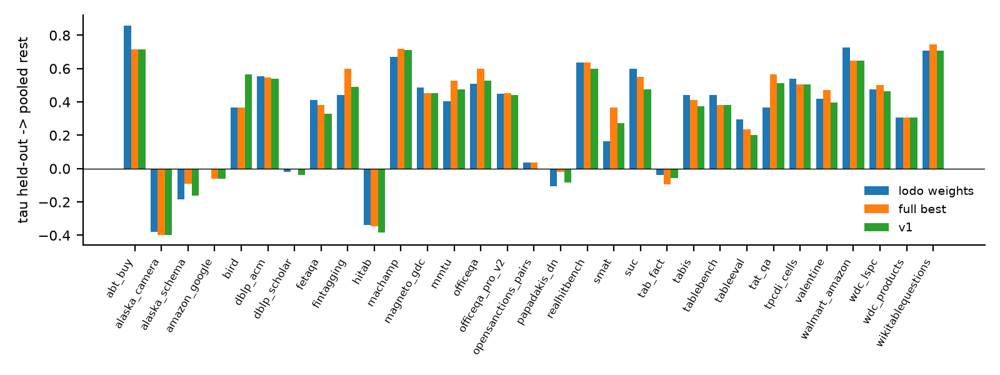

*Leave-one-dataset-out τ.*

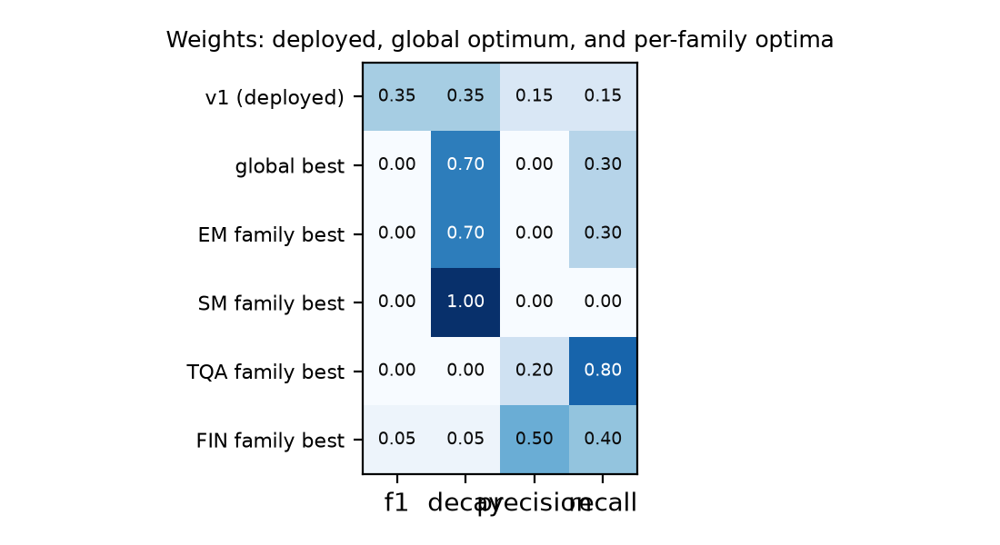

*Per-family weights.*

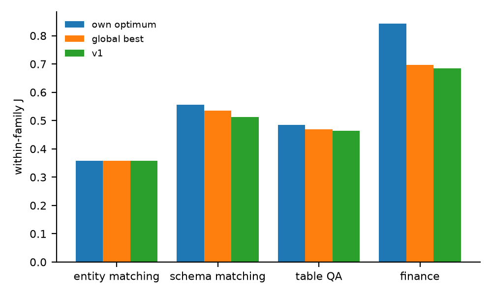

*Within-family J.*

## 7. Sampled designs
Files: `designs.csv`, `designs_summary.json` (three designs × 20 seeds × 100 weightings).
| design | best_J_mean | best_J_sd | best_J_min | regret_mean | regret_max | rank_median | rank_worst | discrepancy | min_L1 | zero_share |
|---|---|---|---|---|---|---|---|---|---|---|
| dirichlet_lattice | 0.4123 | 0.0012 | 0.4102 | 0.0020 | 0.0041 | 11.5000 | 58 | 0.5382 | 0.1000 | 0.2690 |
| lhs_simplex | 0.4126 | 0.0012 | 0.4105 | 0.0017 | 0.0038 | 14.5000 | 49 | 0.5312 | 0.1000 | 0.2795 |
| uniform_lattice | 0.4125 | 0.0012 | 0.4102 | 0.0018 | 0.0041 | 14.5000 | 60 | 0.5256 | 0.1000 | 0.4500 |

All three designs find a weighting within 0.005 of the exhaustive optimum in every seed; the worst seed of any design still lands in the top 49 of 1,771. With four weights the exhaustive grid costs nothing, so the designs are reported only to show that sampling would have sufficed.

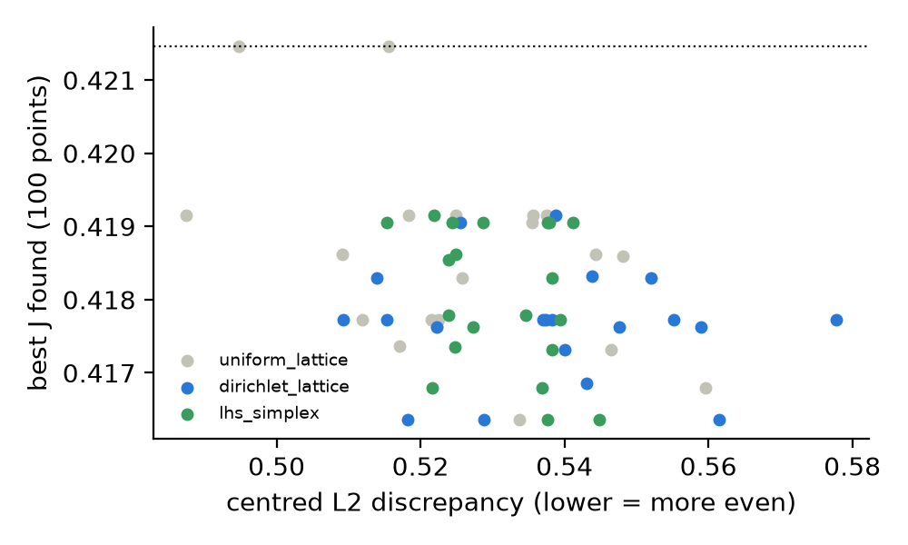

*Designs vs the exhaustive optimum.*

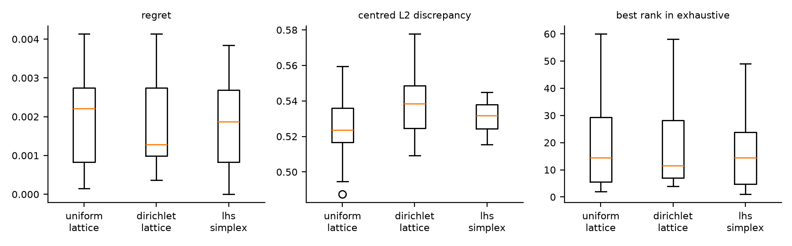

*Design metrics over seeds.*

## 8. Correctness on known-quality anchors
Files: `anchors/anchor_components.csv` (31,380 rows), `correctness.csv` (every weighting), `correctness.json`.
* 31,380 synthetic answers: 9,881 with utility 1, 7,430 with utility 0, the rest partial; 20 operators.
Per operator: utility, mean of each ingredient and of the v1 composite:
| op | n | utility | em | f1 | decay | precision | recall | v1 | v1 − utility |
|---|---|---|---|---|---|---|---|---|---|
| identity | 3083 | 1.000 | 0.999 | 1.000 | 0.999 | 1.000 | 1.000 | 1.000 | -0.000 |
| verbose | 3083 | 1.000 | 0.999 | 1.000 | 0.999 | 1.000 | 1.000 | 1.000 | -0.000 |
| unit_variant | 632 | 1.000 | 0.837 | 0.843 | 1.000 | 0.842 | 0.845 | 0.898 | -0.102 |
| tagged | 3083 | 1.000 | 0.999 | 1.000 | 0.999 | 1.000 | 1.000 | 1.000 | -0.000 |
| paraphrase | 3083 | 0.950 | 0.930 | 0.965 | 0.964 | 0.968 | 0.964 | 0.965 | 0.015 |
| near_miss_small | 632 | 0.750 | 0.097 | 0.112 | 0.949 | 0.113 | 0.112 | 0.405 | -0.345 |
| superset | 1213 | 0.600 | 0.045 | 0.650 | 0.045 | 0.509 | 0.979 | 0.467 | -0.133 |
| typo | 1104 | 0.600 | 0.101 | 0.459 | 0.101 | 0.460 | 0.459 | 0.334 | -0.266 |
| partial | 1213 | 0.500 | 0.061 | 0.481 | 0.061 | 0.609 | 0.424 | 0.345 | -0.155 |
| near_miss_medium | 632 | 0.450 | 0.008 | 0.021 | 0.796 | 0.021 | 0.021 | 0.293 | -0.157 |
| shuffled | 109 | 0.400 | 0.009 | 0.997 | 0.009 | 0.995 | 1.000 | 0.652 | 0.252 |
| hedge | 2974 | 0.300 | 0.192 | 0.504 | 0.405 | 0.413 | 0.756 | 0.493 | 0.193 |
| list_dump | 1845 | 0.250 | 0.013 | 0.394 | 0.144 | 0.258 | 0.976 | 0.373 | 0.123 |
| digit_typo | 632 | 0.200 | 0.000 | 0.013 | 0.543 | 0.013 | 0.013 | 0.199 | -0.001 |
| near_miss_large | 632 | 0.150 | 0.000 | 0.013 | 0.405 | 0.013 | 0.013 | 0.150 | 0.000 |
| sign_flip | 632 | 0.050 | 0.003 | 0.017 | 0.022 | 0.017 | 0.017 | 0.018 | -0.032 |
| magnitude | 632 | 0.050 | 0.013 | 0.027 | 0.209 | 0.028 | 0.027 | 0.091 | 0.041 |
| flip | 1238 | 0.000 | 0.000 | 0.000 | 0.000 | 0.000 | 0.000 | 0.000 | 0.000 |
| no_answer | 3083 | 0.000 | 0.000 | 0.001 | 0.000 | 0.001 | 0.001 | 0.001 | 0.001 |
| wrong_random | 1845 | 0.000 | 0.041 | 0.105 | 0.081 | 0.107 | 0.106 | 0.097 | 0.097 |

Reading: the composite tracks utility well at the ends (identity, verbose, tagged at 1; flip, no answer at 0) and is most generous on `shuffled`, `superset` and `list_dump` (token overlap rewards extra correct tokens) and most severe on `typo`, `digit_typo` and `near_miss_medium` (a changed character or digit destroys both token overlap and numeric closeness). These are the cases a human labeller would score differently from any lexical rule.
Named weightings on the anchors (rank = rank by J):
| label | weights | J | rho | rho_ds | auc | wrong_mean | hedge_gap | rank |
|---|---|---|---|---|---|---|---|---|
| best_rho | F1 0.00 / decay 0.35 / P 0.60 / R 0.05 | 0.391 | 0.883 | 0.871 | 0.994 | 0.034 | -0.573 | 1667.000 |
| v1_original | F1 0.35 / decay 0.35 / P 0.15 / R 0.15 | 0.392 | 0.878 | 0.868 | 0.994 | 0.034 | -0.506 | 1602.000 |
| best_J | F1 0.35 / decay 0.60 / P 0.05 / R 0.00 | 0.414 | 0.876 | 0.866 | 0.994 | 0.036 | -0.560 | 1.000 |
| pareto_knee | F1 0.35 / decay 0.60 / P 0.05 / R 0.00 | 0.414 | 0.876 | 0.866 | 0.994 | 0.036 | -0.560 | 1.000 |
| uniform | F1 0.25 / decay 0.25 / P 0.25 / R 0.25 | 0.401 | 0.875 | 0.866 | 0.994 | 0.033 | -0.480 | 806.000 |
| only_f1 | F1 1.00 / decay 0.00 / P 0.00 / R 0.00 | 0.409 | 0.856 | 0.846 | 0.989 | 0.030 | -0.496 | 96.000 |
| only_precision | F1 0.00 / decay 0.00 / P 1.00 / R 0.00 | 0.386 | 0.848 | 0.839 | 0.989 | 0.031 | -0.587 | 1744.000 |
| exact match | – | – | 0.828 | 0.830 | 0.989 | 0.011 | -0.807 | – |
| only_decay | F1 0.00 / decay 1.00 / P 0.00 / R 0.00 | 0.394 | 0.772 | 0.804 | 0.991 | 0.040 | -0.595 | 1513.000 |
| only_recall | F1 0.00 / decay 0.00 / P 0.00 / R 1.00 | 0.389 | 0.736 | 0.741 | 0.989 | 0.030 | -0.244 | 1703.000 |

Distribution of ρ over the 1,771 weightings:
| 0.0 | 0.1 | 0.5 | 0.9 | 1.0 |
|---|---|---|---|---|
| 0.7365 | 0.8558 | 0.8752 | 0.8804 | 0.8826 |

* ρ ranges 0.736–0.883 (wider than J's range); v1 is at rank 1602 by J but rank 370 by ρ; the best-by-J weighting is rank 722 by ρ. Spearman(J, ρ) across the grid = -0.23. AUC is 0.989–0.994 everywhere: every weighting separates right from wrong; they differ only in partial credit.
Per-dataset ρ under v1 and under exact match:
| dataset | rho v1 | rho em | n |
|---|---|---|---|
| tabis | 0.639 | 0.649 | 1100.000 |
| valentine | 0.846 | 0.844 | 1100.000 |
| wdc_lspc | 0.856 | 0.856 | 700.000 |
| wdc_products | 0.856 | 0.856 | 700.000 |
| alaska_camera | 0.857 | 0.857 | 700.000 |
| machamp | 0.857 | 0.857 | 700.000 |
| suc | 0.857 | 0.826 | 1136.000 |
| dblp_scholar | 0.858 | 0.858 | 700.000 |
| abt_buy | 0.860 | 0.860 | 700.000 |
| opensanctions_pairs | 0.860 | 0.860 | 700.000 |
| dblp_acm | 0.860 | 0.860 | 700.000 |
| tab_fact | 0.862 | 0.862 | 700.000 |
| amazon_google | 0.863 | 0.863 | 700.000 |
| tableeval | 0.866 | 0.814 | 1299.000 |
| walmart_amazon | 0.867 | 0.867 | 700.000 |
| mmtu | 0.868 | 0.836 | 1028.000 |
| magneto_gdc | 0.872 | 0.838 | 1100.000 |
| fintagging | 0.874 | 0.848 | 1100.000 |
| wikitablequestions | 0.877 | 0.821 | 1288.000 |
| alaska_schema | 0.877 | 0.836 | 1023.000 |
| officeqa_pro_v2 | 0.885 | 0.757 | 1258.000 |
| tat_qa | 0.885 | 0.796 | 1332.000 |
| bird | 0.889 | 0.820 | 1300.000 |
| papadakis_dn | 0.891 | 0.891 | 700.000 |
| officeqa | 0.894 | 0.769 | 1456.000 |
| tablebench | 0.898 | 0.823 | 1308.000 |
| realhitbench | 0.899 | 0.824 | 1296.000 |
| tpcdi_cells | 0.905 | 0.812 | 1400.000 |
| hitab | 0.906 | 0.826 | 1356.000 |
| fetaqa | 0.913 | 0.811 | 1000.000 |
| smat | 0.914 | 0.839 | 1100.000 |

Pareto front over (J, ρ): 17 weightings.
| weights | J | rho | auc |
|---|---|---|---|
| F1 0.35 / decay 0.60 / P 0.05 / R 0.00 | 0.414 | 0.876 | 0.994 |
| F1 0.30 / decay 0.25 / P 0.35 / R 0.10 | 0.412 | 0.877 | 0.994 |
| F1 0.60 / decay 0.15 / P 0.25 / R 0.00 | 0.412 | 0.878 | 0.994 |
| F1 0.55 / decay 0.15 / P 0.30 / R 0.00 | 0.410 | 0.878 | 0.994 |
| F1 0.65 / decay 0.25 / P 0.10 / R 0.00 | 0.409 | 0.878 | 0.994 |
| F1 0.45 / decay 0.20 / P 0.35 / R 0.00 | 0.408 | 0.878 | 0.994 |
| F1 0.35 / decay 0.55 / P 0.10 / R 0.00 | 0.407 | 0.879 | 0.994 |
| F1 0.50 / decay 0.40 / P 0.10 / R 0.00 | 0.407 | 0.882 | 0.994 |
| F1 0.35 / decay 0.40 / P 0.25 / R 0.00 | 0.403 | 0.882 | 0.994 |
| F1 0.45 / decay 0.40 / P 0.15 / R 0.00 | 0.401 | 0.882 | 0.994 |
| F1 0.30 / decay 0.40 / P 0.25 / R 0.05 | 0.399 | 0.882 | 0.994 |
| F1 0.10 / decay 0.35 / P 0.50 / R 0.05 | 0.399 | 0.882 | 0.994 |
| F1 0.35 / decay 0.45 / P 0.15 / R 0.05 | 0.398 | 0.882 | 0.994 |
| F1 0.05 / decay 0.35 / P 0.55 / R 0.05 | 0.395 | 0.882 | 0.994 |
| F1 0.25 / decay 0.45 / P 0.20 / R 0.10 | 0.395 | 0.882 | 0.994 |
| F1 0.15 / decay 0.35 / P 0.50 / R 0.00 | 0.394 | 0.882 | 0.994 |
| F1 0.00 / decay 0.35 / P 0.60 / R 0.05 | 0.391 | 0.883 | 0.994 |

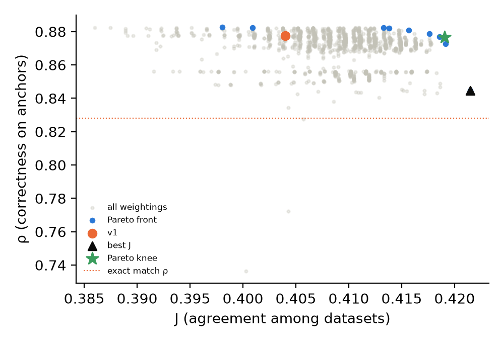

*J vs ρ.*

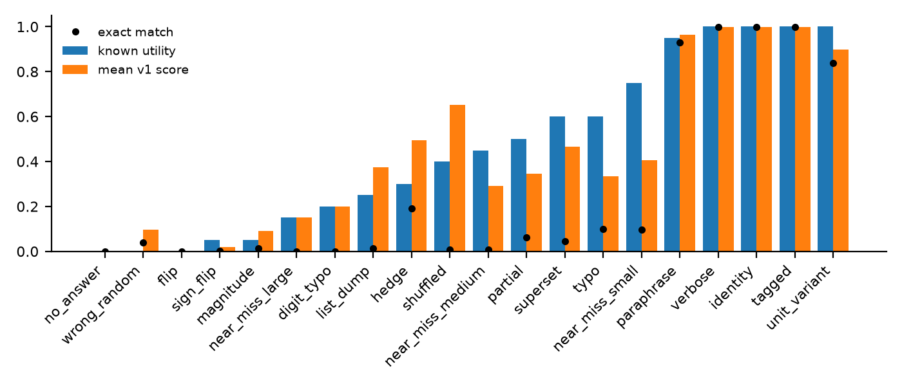

*Operators: utility vs score.*

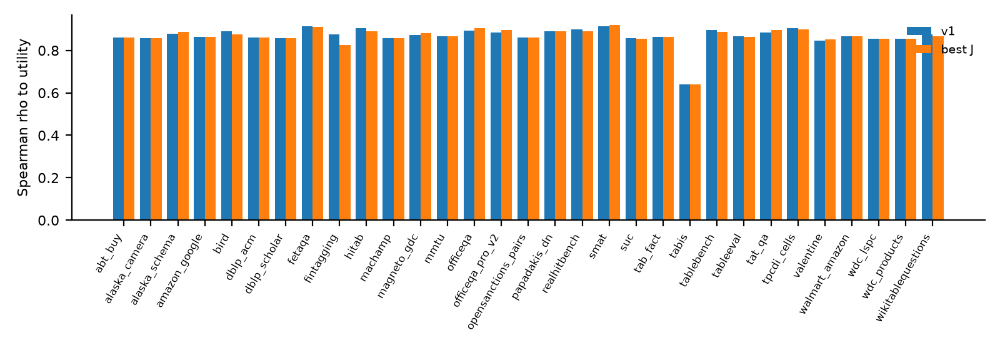

*ρ per dataset.*

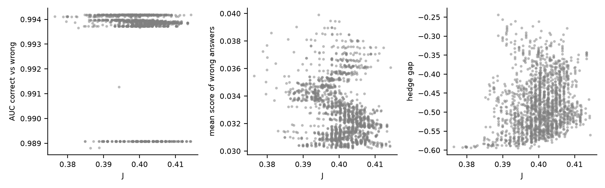

*AUC, wrong-mean and hedge gap vs J.*

## 9. Leaderboards under every rule
Files: `leaderboards/<rule>/leaderboard.csv`, `params.json`, `bootstrap.npz`, `rule_agreement.csv`.

**exact match** — weights: exact match only; Kemeny cost 398 of 1705; BT converged: True, comparisons 169,565.

| model | BT strength | SE | BT rank | BT 95 % | P(first) BT | Borda | Borda 95 % | P(first) Borda | Kemeny | Copeland | mean-z | RRF | fam-bal z | mean score |
|---|---|---|---|---|---|---|---|---|---|---|---|---|---|---|
| Gemini 3.8 Flash | 0.034 | 0.015 | 3 | [1, 4] | 0.072 | 3 | [2, 5] | 0.010 | 3 | 3.000 | 3 | 3 | 3 | 0.763 |
| Claude Opus 5 | 0.045 | 0.000 | 1 | [1, 3] | 0.790 | 1 | [1, 2] | 0.828 | 1 | 1.000 | 1 | 1 | 1 | 0.768 |
| GPT-5.5 | 0.036 | 0.015 | 2 | [1, 4] | 0.136 | 2 | [1, 3] | 0.156 | 2 | 2.000 | 2 | 2 | 2 | 0.764 |
| Claude Sonnet 5 | 0.011 | 0.015 | 7 | [4, 8] | 0.000 | 4 | [3, 7] | 0.000 | 4 | 4.000 | 5 | 4 | 4 | 0.751 |
| Gemini 3.1 Pro | 0.019 | 0.015 | 4 | [3, 7] | 0.000 | 7 | [4, 8] | 0.000 | 7 | 6.500 | 6 | 7 | 6 | 0.755 |
| Grok 4 | 0.017 | 0.015 | 5 | [4, 8] | 0.000 | 6 | [3, 8] | 0.000 | 6 | 5.000 | 7 | 6 | 7 | 0.754 |
| DeepSeek-R1 | 0.016 | 0.015 | 6 | [4, 8] | 0.000 | 5 | [3, 7] | 0.000 | 5 | 6.500 | 4 | 5 | 5 | 0.754 |
| GPT-5.4-mini | 0.007 | 0.015 | 8 | [4, 8] | 0.000 | 9 | [7, 9] | 0.000 | 8 | 8.000 | 8 | 9 | 9 | 0.749 |
| DeepSeek-chat | -0.017 | 0.015 | 9 | [9, 10] | 0.000 | 8 | [7, 9] | 0.000 | 9 | 9.000 | 9 | 8 | 8 | 0.737 |
| gpt-oss-120b | -0.036 | 0.015 | 10 | [9, 10] | 0.000 | 10 | [10, 10] | 0.000 | 10 | 10.000 | 10 | 10 | 10 | 0.728 |
| Llama 3.3 70B | -0.131 | 0.015 | 11 | [11, 11] | 0.000 | 11 | [11, 11] | 0.000 | 11 | 11.000 | 11 | 11 | 11 | 0.680 |

**v1 (deployed)** — weights: F1 0.35 / decay 0.35 / P 0.15 / R 0.15; Kemeny cost 460 of 1705; BT converged: True, comparisons 169,565.

| model | BT strength | SE | BT rank | BT 95 % | P(first) BT | Borda | Borda 95 % | P(first) Borda | Kemeny | Copeland | mean-z | RRF | fam-bal z | mean score |
|---|---|---|---|---|---|---|---|---|---|---|---|---|---|---|
| Gemini 3.8 Flash | 0.115 | 0.015 | 1 | [1, 2] | 0.912 | 3 | [1, 3] | 0.043 | 3 | 3.000 | 3 | 3 | 2 | 0.812 |
| Claude Opus 5 | 0.101 | 0.000 | 2 | [1, 2] | 0.088 | 2 | [1, 3] | 0.505 | 1 | 1.000 | 1 | 2 | 1 | 0.812 |
| GPT-5.5 | 0.045 | 0.015 | 3 | [3, 5] | 0.000 | 1 | [1, 3] | 0.436 | 2 | 2.000 | 2 | 1 | 3 | 0.808 |
| Claude Sonnet 5 | 0.027 | 0.015 | 4 | [3, 6] | 0.000 | 4 | [4, 7] | 0.000 | 5 | 5.000 | 4 | 4 | 4 | 0.796 |
| Gemini 3.1 Pro | 0.026 | 0.015 | 5 | [3, 6] | 0.000 | 6 | [4, 7] | 0.000 | 4 | 4.000 | 5 | 6 | 5 | 0.799 |
| Grok 4 | 0.020 | 0.015 | 6 | [4, 6] | 0.000 | 7 | [4, 7] | 0.000 | 6 | 6.000 | 6 | 7 | 6 | 0.797 |
| DeepSeek-R1 | -0.007 | 0.015 | 7 | [7, 9] | 0.000 | 5 | [4, 8] | 0.000 | 7 | 7.000 | 7 | 5 | 7 | 0.794 |
| GPT-5.4-mini | -0.017 | 0.015 | 8 | [7, 9] | 0.000 | 9 | [7, 9] | 0.000 | 8 | 8.000 | 8 | 9 | 8 | 0.789 |
| DeepSeek-chat | -0.026 | 0.015 | 9 | [7, 9] | 0.000 | 8 | [7, 9] | 0.000 | 9 | 9.000 | 9 | 8 | 9 | 0.783 |
| gpt-oss-120b | -0.107 | 0.015 | 10 | [10, 10] | 0.000 | 10 | [10, 11] | 0.000 | 10 | 10.000 | 10 | 10 | 10 | 0.767 |
| Llama 3.3 70B | -0.177 | 0.015 | 11 | [11, 11] | 0.000 | 11 | [10, 11] | 0.000 | 11 | 11.000 | 11 | 11 | 11 | 0.739 |

**top1 (best J)** — weights: F1 0.35 / decay 0.60 / P 0.05 / R 0.00; Kemeny cost 451 of 1705; BT converged: True, comparisons 169,565.

| model | BT strength | SE | BT rank | BT 95 % | P(first) BT | Borda | Borda 95 % | P(first) Borda | Kemeny | Copeland | mean-z | RRF | fam-bal z | mean score |
|---|---|---|---|---|---|---|---|---|---|---|---|---|---|---|
| Gemini 3.8 Flash | 0.115 | 0.015 | 1 | [1, 2] | 0.927 | 3 | [1, 4] | 0.048 | 3 | 3.000 | 3 | 3 | 2 | 0.809 |
| Claude Opus 5 | 0.099 | 0.000 | 2 | [1, 2] | 0.073 | 2 | [1, 3] | 0.498 | 1 | 1.000 | 1 | 2 | 1 | 0.810 |
| GPT-5.5 | 0.046 | 0.015 | 3 | [3, 5] | 0.000 | 1 | [1, 3] | 0.444 | 2 | 2.000 | 2 | 1 | 3 | 0.804 |
| Claude Sonnet 5 | 0.029 | 0.015 | 4 | [3, 6] | 0.000 | 4 | [4, 7] | 0.000 | 4 | 4.000 | 4 | 4 | 4 | 0.793 |
| Gemini 3.1 Pro | 0.027 | 0.015 | 5 | [3, 6] | 0.000 | 5 | [4, 7] | 0.000 | 6 | 6.000 | 5 | 6 | 5 | 0.794 |
| Grok 4 | 0.021 | 0.015 | 6 | [4, 6] | 0.000 | 5 | [4, 8] | 0.000 | 5 | 5.000 | 6 | 5 | 6 | 0.792 |
| DeepSeek-R1 | -0.009 | 0.015 | 7 | [7, 9] | 0.000 | 7 | [4, 8] | 0.000 | 7 | 7.000 | 7 | 7 | 8 | 0.788 |
| GPT-5.4-mini | -0.015 | 0.015 | 8 | [7, 9] | 0.000 | 8 | [6, 9] | 0.000 | 8 | 8.000 | 8 | 8 | 7 | 0.788 |
| DeepSeek-chat | -0.026 | 0.015 | 9 | [7, 9] | 0.000 | 9 | [7, 9] | 0.000 | 9 | 9.000 | 9 | 9 | 9 | 0.776 |
| gpt-oss-120b | -0.109 | 0.015 | 10 | [10, 10] | 0.000 | 10 | [10, 11] | 0.000 | 10 | 10.000 | 10 | 10 | 10 | 0.762 |
| Llama 3.3 70B | -0.179 | 0.015 | 11 | [11, 11] | 0.000 | 11 | [10, 11] | 0.000 | 11 | 11.000 | 11 | 11 | 11 | 0.730 |

**top2** — weights: F1 0.80 / decay 0.00 / P 0.20 / R 0.00; Kemeny cost 444 of 1705; BT converged: True, comparisons 169,565.

| model | BT strength | SE | BT rank | BT 95 % | P(first) BT | Borda | Borda 95 % | P(first) Borda | Kemeny | Copeland | mean-z | RRF | fam-bal z | mean score |
|---|---|---|---|---|---|---|---|---|---|---|---|---|---|---|
| Gemini 3.8 Flash | 0.065 | 0.015 | 1 | [1, 2] | 0.791 | 3 | [1, 4] | 0.043 | 3 | 3.000 | 3 | 3 | 3 | 0.814 |
| Claude Opus 5 | 0.048 | 0.000 | 3 | [1, 4] | 0.027 | 1 | [1, 3] | 0.598 | 1 | 1.000 | 1 | 1 | 1 | 0.812 |
| GPT-5.5 | 0.057 | 0.015 | 2 | [1, 3] | 0.182 | 2 | [1, 3] | 0.351 | 2 | 2.000 | 2 | 2 | 2 | 0.812 |
| Claude Sonnet 5 | 0.011 | 0.015 | 7 | [5, 8] | 0.000 | 5 | [4, 8] | 0.000 | 5 | 5.000 | 4 | 5 | 4 | 0.798 |
| Gemini 3.1 Pro | 0.034 | 0.015 | 4 | [3, 6] | 0.000 | 4 | [4, 7] | 0.000 | 4 | 4.000 | 5 | 4 | 5 | 0.804 |
| Grok 4 | 0.028 | 0.015 | 5 | [4, 7] | 0.000 | 6 | [4, 8] | 0.000 | 6 | 6.000 | 6 | 6 | 8 | 0.801 |
| DeepSeek-R1 | 0.024 | 0.015 | 6 | [4, 7] | 0.000 | 7 | [4, 8] | 0.000 | 7 | 7.000 | 7 | 7 | 6 | 0.799 |
| GPT-5.4-mini | -0.017 | 0.015 | 9 | [8, 9] | 0.000 | 9 | [8, 9] | 0.000 | 9 | 9.000 | 9 | 9 | 9 | 0.791 |
| DeepSeek-chat | 0.000 | 0.015 | 8 | [7, 9] | 0.000 | 8 | [5, 9] | 0.000 | 8 | 8.000 | 8 | 8 | 7 | 0.792 |
| gpt-oss-120b | -0.076 | 0.015 | 10 | [10, 10] | 0.000 | 10 | [10, 11] | 0.000 | 10 | 10.000 | 10 | 10 | 10 | 0.771 |
| Llama 3.3 70B | -0.173 | 0.015 | 11 | [11, 11] | 0.000 | 11 | [10, 11] | 0.000 | 11 | 11.000 | 11 | 11 | 11 | 0.745 |

**top3** — weights: F1 0.85 / decay 0.00 / P 0.15 / R 0.00; Kemeny cost 444 of 1705; BT converged: True, comparisons 169,565.

| model | BT strength | SE | BT rank | BT 95 % | P(first) BT | Borda | Borda 95 % | P(first) Borda | Kemeny | Copeland | mean-z | RRF | fam-bal z | mean score |
|---|---|---|---|---|---|---|---|---|---|---|---|---|---|---|
| Gemini 3.8 Flash | 0.065 | 0.015 | 1 | [1, 3] | 0.805 | 3 | [1, 4] | 0.043 | 3 | 3.000 | 3 | 3 | 3 | 0.814 |
| Claude Opus 5 | 0.049 | 0.000 | 3 | [1, 4] | 0.038 | 1 | [1, 3] | 0.604 | 1 | 1.000 | 1 | 1 | 1 | 0.812 |
| GPT-5.5 | 0.057 | 0.015 | 2 | [1, 3] | 0.156 | 2 | [1, 3] | 0.348 | 2 | 2.000 | 2 | 2 | 2 | 0.812 |
| Claude Sonnet 5 | 0.011 | 0.015 | 7 | [5, 8] | 0.000 | 5 | [4, 8] | 0.000 | 5 | 5.000 | 4 | 5 | 4 | 0.797 |
| Gemini 3.1 Pro | 0.033 | 0.015 | 4 | [3, 6] | 0.001 | 4 | [4, 7] | 0.000 | 4 | 4.000 | 5 | 4 | 5 | 0.804 |
| Grok 4 | 0.029 | 0.015 | 5 | [4, 7] | 0.000 | 6 | [4, 8] | 0.000 | 6 | 6.000 | 6 | 6 | 8 | 0.801 |
| DeepSeek-R1 | 0.024 | 0.015 | 6 | [4, 7] | 0.000 | 7 | [4, 8] | 0.000 | 7 | 7.000 | 7 | 7 | 6 | 0.799 |
| GPT-5.4-mini | -0.018 | 0.015 | 9 | [8, 9] | 0.000 | 9 | [8, 9] | 0.000 | 9 | 9.000 | 9 | 9 | 9 | 0.790 |
| DeepSeek-chat | -0.000 | 0.015 | 8 | [7, 9] | 0.000 | 8 | [5, 9] | 0.000 | 8 | 8.000 | 8 | 8 | 7 | 0.792 |
| gpt-oss-120b | -0.075 | 0.015 | 10 | [10, 10] | 0.000 | 10 | [10, 11] | 0.000 | 10 | 10.000 | 10 | 10 | 10 | 0.771 |
| Llama 3.3 70B | -0.175 | 0.015 | 11 | [11, 11] | 0.000 | 11 | [10, 11] | 0.000 | 11 | 11.000 | 11 | 11 | 11 | 0.744 |

**top4** — weights: F1 0.20 / decay 0.00 / P 0.50 / R 0.30; Kemeny cost 446 of 1705; BT converged: True, comparisons 169,565.

| model | BT strength | SE | BT rank | BT 95 % | P(first) BT | Borda | Borda 95 % | P(first) Borda | Kemeny | Copeland | mean-z | RRF | fam-bal z | mean score |
|---|---|---|---|---|---|---|---|---|---|---|---|---|---|---|
| Gemini 3.8 Flash | 0.062 | 0.015 | 1 | [1, 2] | 0.791 | 3 | [1, 4] | 0.052 | 3 | 3.000 | 3 | 3 | 3 | 0.816 |
| Claude Opus 5 | 0.045 | 0.000 | 3 | [1, 5] | 0.027 | 1 | [1, 3] | 0.593 | 1 | 1.000 | 1 | 1 | 1 | 0.815 |
| GPT-5.5 | 0.054 | 0.015 | 2 | [1, 3] | 0.182 | 2 | [1, 3] | 0.346 | 2 | 2.000 | 2 | 2 | 2 | 0.814 |
| Claude Sonnet 5 | 0.011 | 0.015 | 7 | [5, 8] | 0.000 | 5 | [4, 8] | 0.000 | 5 | 5.000 | 4 | 5 | 4 | 0.801 |
| Gemini 3.1 Pro | 0.029 | 0.015 | 4 | [3, 7] | 0.000 | 4 | [4, 7] | 0.000 | 4 | 4.000 | 5 | 4 | 6 | 0.807 |
| Grok 4 | 0.023 | 0.015 | 6 | [4, 7] | 0.000 | 7 | [4, 8] | 0.000 | 7 | 7.500 | 7 | 7 | 8 | 0.804 |
| DeepSeek-R1 | 0.028 | 0.015 | 5 | [3, 7] | 0.000 | 5 | [4, 8] | 0.000 | 6 | 6.000 | 6 | 6 | 5 | 0.804 |
| GPT-5.4-mini | -0.012 | 0.015 | 9 | [8, 9] | 0.000 | 9 | [8, 9] | 0.000 | 9 | 9.000 | 9 | 9 | 9 | 0.795 |
| DeepSeek-chat | -0.000 | 0.015 | 8 | [7, 9] | 0.000 | 8 | [5, 9] | 0.000 | 8 | 7.500 | 8 | 8 | 7 | 0.795 |
| gpt-oss-120b | -0.081 | 0.015 | 10 | [10, 10] | 0.000 | 10 | [10, 11] | 0.000 | 10 | 10.000 | 10 | 10 | 10 | 0.774 |
| Llama 3.3 70B | -0.160 | 0.015 | 11 | [11, 11] | 0.000 | 11 | [10, 11] | 0.000 | 11 | 11.000 | 11 | 11 | 11 | 0.752 |

**top5** — weights: F1 0.00 / decay 0.15 / P 0.15 / R 0.70; Kemeny cost 451 of 1705; BT converged: True, comparisons 169,565.

| model | BT strength | SE | BT rank | BT 95 % | P(first) BT | Borda | Borda 95 % | P(first) Borda | Kemeny | Copeland | mean-z | RRF | fam-bal z | mean score |
|---|---|---|---|---|---|---|---|---|---|---|---|---|---|---|
| Gemini 3.8 Flash | 0.117 | 0.015 | 1 | [1, 2] | 0.832 | 3 | [1, 4] | 0.052 | 3 | 3.000 | 3 | 3 | 3 | 0.814 |
| Claude Opus 5 | 0.107 | 0.000 | 2 | [1, 2] | 0.168 | 1 | [1, 3] | 0.597 | 1 | 1.000 | 1 | 1 | 1 | 0.814 |
| GPT-5.5 | 0.044 | 0.015 | 3 | [3, 4] | 0.000 | 2 | [1, 3] | 0.339 | 2 | 2.000 | 2 | 2 | 2 | 0.811 |
| Claude Sonnet 5 | 0.026 | 0.015 | 4 | [3, 6] | 0.000 | 6 | [4, 8] | 0.000 | 5 | 5.000 | 5 | 5 | 4 | 0.799 |
| Gemini 3.1 Pro | 0.021 | 0.015 | 5 | [3, 6] | 0.000 | 6 | [4, 7] | 0.000 | 4 | 4.000 | 6 | 7 | 6 | 0.804 |
| Grok 4 | 0.017 | 0.015 | 6 | [4, 7] | 0.000 | 5 | [4, 7] | 0.000 | 6 | 6.000 | 7 | 6 | 7 | 0.801 |
| DeepSeek-R1 | -0.001 | 0.015 | 7 | [5, 8] | 0.000 | 4 | [4, 7] | 0.000 | 7 | 7.000 | 4 | 4 | 5 | 0.803 |
| GPT-5.4-mini | -0.028 | 0.015 | 9 | [8, 9] | 0.000 | 9 | [8, 9] | 0.000 | 9 | 9.000 | 8 | 9 | 9 | 0.789 |
| DeepSeek-chat | -0.026 | 0.015 | 8 | [8, 9] | 0.000 | 8 | [7, 9] | 0.000 | 8 | 8.000 | 9 | 8 | 8 | 0.791 |
| gpt-oss-120b | -0.089 | 0.015 | 10 | [10, 10] | 0.000 | 10 | [10, 11] | 0.000 | 10 | 10.000 | 10 | 10 | 10 | 0.774 |
| Llama 3.3 70B | -0.188 | 0.015 | 11 | [11, 11] | 0.000 | 11 | [10, 11] | 0.000 | 11 | 11.000 | 11 | 11 | 11 | 0.749 |

**best-rho** — weights: F1 0.00 / decay 0.35 / P 0.60 / R 0.05; Kemeny cost 467 of 1705; BT converged: True, comparisons 169,565.

| model | BT strength | SE | BT rank | BT 95 % | P(first) BT | Borda | Borda 95 % | P(first) Borda | Kemeny | Copeland | mean-z | RRF | fam-bal z | mean score |
|---|---|---|---|---|---|---|---|---|---|---|---|---|---|---|
| Gemini 3.8 Flash | 0.099 | 0.015 | 1 | [1, 2] | 0.949 | 3 | [1, 4] | 0.036 | 3 | 3.000 | 3 | 3 | 2 | 0.814 |
| Claude Opus 5 | 0.082 | 0.000 | 2 | [1, 2] | 0.051 | 2 | [1, 3] | 0.426 | 1 | 1.000 | 1 | 2 | 1 | 0.813 |
| GPT-5.5 | 0.038 | 0.015 | 3 | [3, 5] | 0.000 | 1 | [1, 3] | 0.527 | 2 | 2.000 | 2 | 1 | 3 | 0.810 |
| Claude Sonnet 5 | 0.034 | 0.015 | 4 | [3, 6] | 0.000 | 4 | [4, 8] | 0.000 | 5 | 5.000 | 4 | 4 | 4 | 0.799 |
| Gemini 3.1 Pro | 0.020 | 0.015 | 5 | [3, 7] | 0.000 | 5 | [4, 7] | 0.000 | 4 | 4.000 | 5 | 5 | 5 | 0.801 |
| Grok 4 | 0.007 | 0.015 | 7 | [5, 8] | 0.000 | 7 | [4, 8] | 0.000 | 7 | 8.000 | 7 | 7 | 7 | 0.798 |
| DeepSeek-R1 | -0.008 | 0.015 | 8 | [7, 8] | 0.000 | 6 | [4, 8] | 0.000 | 6 | 6.000 | 6 | 6 | 6 | 0.796 |
| GPT-5.4-mini | 0.019 | 0.015 | 6 | [3, 7] | 0.000 | 8 | [6, 9] | 0.000 | 8 | 7.000 | 8 | 8 | 8 | 0.796 |
| DeepSeek-chat | -0.035 | 0.015 | 9 | [9, 9] | 0.000 | 9 | [7, 9] | 0.000 | 9 | 9.000 | 9 | 9 | 9 | 0.785 |
| gpt-oss-120b | -0.124 | 0.015 | 10 | [10, 11] | 0.000 | 10 | [10, 11] | 0.000 | 10 | 10.000 | 10 | 10 | 10 | 0.768 |
| Llama 3.3 70B | -0.132 | 0.015 | 11 | [10, 11] | 0.000 | 11 | [10, 11] | 0.000 | 11 | 11.000 | 11 | 11 | 11 | 0.744 |

**Pareto knee** — weights: F1 0.35 / decay 0.60 / P 0.05 / R 0.00; Kemeny cost 451 of 1705; BT converged: True, comparisons 169,565.

| model | BT strength | SE | BT rank | BT 95 % | P(first) BT | Borda | Borda 95 % | P(first) Borda | Kemeny | Copeland | mean-z | RRF | fam-bal z | mean score |
|---|---|---|---|---|---|---|---|---|---|---|---|---|---|---|
| Gemini 3.8 Flash | 0.115 | 0.015 | 1 | [1, 2] | 0.927 | 3 | [1, 4] | 0.048 | 3 | 3.000 | 3 | 3 | 2 | 0.809 |
| Claude Opus 5 | 0.099 | 0.000 | 2 | [1, 2] | 0.073 | 2 | [1, 3] | 0.498 | 1 | 1.000 | 1 | 2 | 1 | 0.810 |
| GPT-5.5 | 0.046 | 0.015 | 3 | [3, 5] | 0.000 | 1 | [1, 3] | 0.444 | 2 | 2.000 | 2 | 1 | 3 | 0.804 |
| Claude Sonnet 5 | 0.029 | 0.015 | 4 | [3, 6] | 0.000 | 4 | [4, 7] | 0.000 | 4 | 4.000 | 4 | 4 | 4 | 0.793 |
| Gemini 3.1 Pro | 0.027 | 0.015 | 5 | [3, 6] | 0.000 | 5 | [4, 7] | 0.000 | 6 | 6.000 | 5 | 6 | 5 | 0.794 |
| Grok 4 | 0.021 | 0.015 | 6 | [4, 6] | 0.000 | 5 | [4, 8] | 0.000 | 5 | 5.000 | 6 | 5 | 6 | 0.792 |
| DeepSeek-R1 | -0.009 | 0.015 | 7 | [7, 9] | 0.000 | 7 | [4, 8] | 0.000 | 7 | 7.000 | 7 | 7 | 8 | 0.788 |
| GPT-5.4-mini | -0.015 | 0.015 | 8 | [7, 9] | 0.000 | 8 | [6, 9] | 0.000 | 8 | 8.000 | 8 | 8 | 7 | 0.788 |
| DeepSeek-chat | -0.026 | 0.015 | 9 | [7, 9] | 0.000 | 9 | [7, 9] | 0.000 | 9 | 9.000 | 9 | 9 | 9 | 0.776 |
| gpt-oss-120b | -0.109 | 0.015 | 10 | [10, 10] | 0.000 | 10 | [10, 11] | 0.000 | 10 | 10.000 | 10 | 10 | 10 | 0.762 |
| Llama 3.3 70B | -0.179 | 0.015 | 11 | [11, 11] | 0.000 | 11 | [10, 11] | 0.000 | 11 | 11.000 | 11 | 11 | 11 | 0.730 |

Agreement between the Bradley–Terry rankings of the rules (Kendall τ):
| index | exact match | v1 (deployed) | top1 (best J) | top2 | top3 | top4 | top5 | best-rho | Pareto knee |
|---|---|---|---|---|---|---|---|---|---|
| exact match | 1.00 | 0.82 | 0.82 | 0.85 | 0.85 | 0.82 | 0.78 | 0.75 | 0.82 |
| v1 (deployed) | 0.82 | 1.00 | 1.00 | 0.82 | 0.82 | 0.78 | 0.96 | 0.93 | 1.00 |
| top1 (best J) | 0.82 | 1.00 | 1.00 | 0.82 | 0.82 | 0.78 | 0.96 | 0.93 | 1.00 |
| top2 | 0.85 | 0.82 | 0.82 | 1.00 | 1.00 | 0.96 | 0.85 | 0.75 | 0.82 |
| top3 | 0.85 | 0.82 | 0.82 | 1.00 | 1.00 | 0.96 | 0.85 | 0.75 | 0.82 |
| top4 | 0.82 | 0.78 | 0.78 | 0.96 | 0.96 | 1.00 | 0.82 | 0.71 | 0.78 |
| top5 | 0.78 | 0.96 | 0.96 | 0.85 | 0.85 | 0.82 | 1.00 | 0.89 | 0.96 |
| best-rho | 0.75 | 0.93 | 0.93 | 0.75 | 0.75 | 0.71 | 0.89 | 1.00 | 0.93 |
| Pareto knee | 0.82 | 1.00 | 1.00 | 0.82 | 0.82 | 0.78 | 0.96 | 0.93 | 1.00 |

Who is first under each rule and pooling method:
| rule | first (BT) | P(first) | first (Borda) | first (Kemeny) | first (mean-z) | last (BT) |
|---|---|---|---|---|---|---|
| exact match | Claude Opus 5 | 0.790 | Claude Opus 5 | Claude Opus 5 | Claude Opus 5 | Llama 3.3 70B |
| v1 (deployed) | Gemini 3.8 Flash | 0.912 | GPT-5.5 | Claude Opus 5 | Claude Opus 5 | Llama 3.3 70B |
| top1 (best J) | Gemini 3.8 Flash | 0.927 | GPT-5.5 | Claude Opus 5 | Claude Opus 5 | Llama 3.3 70B |
| top2 | Gemini 3.8 Flash | 0.791 | Claude Opus 5 | Claude Opus 5 | Claude Opus 5 | Llama 3.3 70B |
| top3 | Gemini 3.8 Flash | 0.805 | Claude Opus 5 | Claude Opus 5 | Claude Opus 5 | Llama 3.3 70B |
| top4 | Gemini 3.8 Flash | 0.791 | Claude Opus 5 | Claude Opus 5 | Claude Opus 5 | Llama 3.3 70B |
| top5 | Gemini 3.8 Flash | 0.832 | Claude Opus 5 | Claude Opus 5 | Claude Opus 5 | Llama 3.3 70B |
| best-rho | Gemini 3.8 Flash | 0.949 | GPT-5.5 | Claude Opus 5 | Claude Opus 5 | Llama 3.3 70B |
| Pareto knee | Gemini 3.8 Flash | 0.927 | GPT-5.5 | Claude Opus 5 | Claude Opus 5 | Llama 3.3 70B |

* Under v1, Bradley–Terry gives Gemini 3.8 Flash P(first) = 0.91 while Borda gives it 0.04 and splits first place three ways (Opus 0.51, GPT-5.5 0.44). The two pooling methods answer different questions: BT counts item-level wins (Flash wins many items by small margins), Borda counts dataset-level ranks (GPT-5.5 and Opus top more datasets).
Bootstrap distribution of the Bradley–Terry rank under v1 (share of 1,000 resamples):
| model | rank 1 | rank 2 | rank 3 | rank 4 | rank 5 | rank 6 | rank 7 | rank 8 | rank 9 | rank 10 | rank 11 |
|---|---|---|---|---|---|---|---|---|---|---|---|
| Gemini 3.8 Flash | 0.91 | 0.09 | 0.00 | 0.00 | 0.00 | 0.00 | 0.00 | 0.00 | 0.00 | 0.00 | 0.00 |
| Claude Opus 5 | 0.09 | 0.91 | 0.00 | 0.00 | 0.00 | 0.00 | 0.00 | 0.00 | 0.00 | 0.00 | 0.00 |
| GPT-5.5 | 0.00 | 0.00 | 0.87 | 0.10 | 0.03 | 0.00 | 0.00 | 0.00 | 0.00 | 0.00 | 0.00 |
| Claude Sonnet 5 | 0.00 | 0.00 | 0.06 | 0.41 | 0.32 | 0.20 | 0.00 | 0.00 | 0.00 | 0.00 | 0.00 |
| Gemini 3.1 Pro | 0.00 | 0.00 | 0.06 | 0.34 | 0.40 | 0.20 | 0.00 | 0.00 | 0.00 | 0.00 | 0.00 |
| Grok 4 | 0.00 | 0.00 | 0.01 | 0.15 | 0.26 | 0.57 | 0.02 | 0.00 | 0.00 | 0.00 | 0.00 |
| DeepSeek-R1 | 0.00 | 0.00 | 0.00 | 0.00 | 0.00 | 0.02 | 0.75 | 0.20 | 0.03 | 0.00 | 0.00 |
| GPT-5.4-mini | 0.00 | 0.00 | 0.00 | 0.00 | 0.00 | 0.00 | 0.20 | 0.56 | 0.24 | 0.00 | 0.00 |
| DeepSeek-chat | 0.00 | 0.00 | 0.00 | 0.00 | 0.00 | 0.00 | 0.03 | 0.24 | 0.73 | 0.00 | 0.00 |
| gpt-oss-120b | 0.00 | 0.00 | 0.00 | 0.00 | 0.00 | 0.00 | 0.00 | 0.00 | 0.00 | 1.00 | 0.00 |
| Llama 3.3 70B | 0.00 | 0.00 | 0.00 | 0.00 | 0.00 | 0.00 | 0.00 | 0.00 | 0.00 | 0.00 | 1.00 |

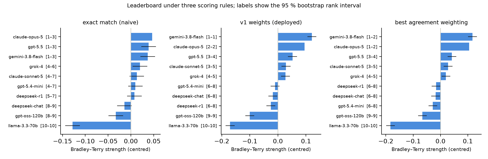

*BT strengths and rank intervals under three rules.*

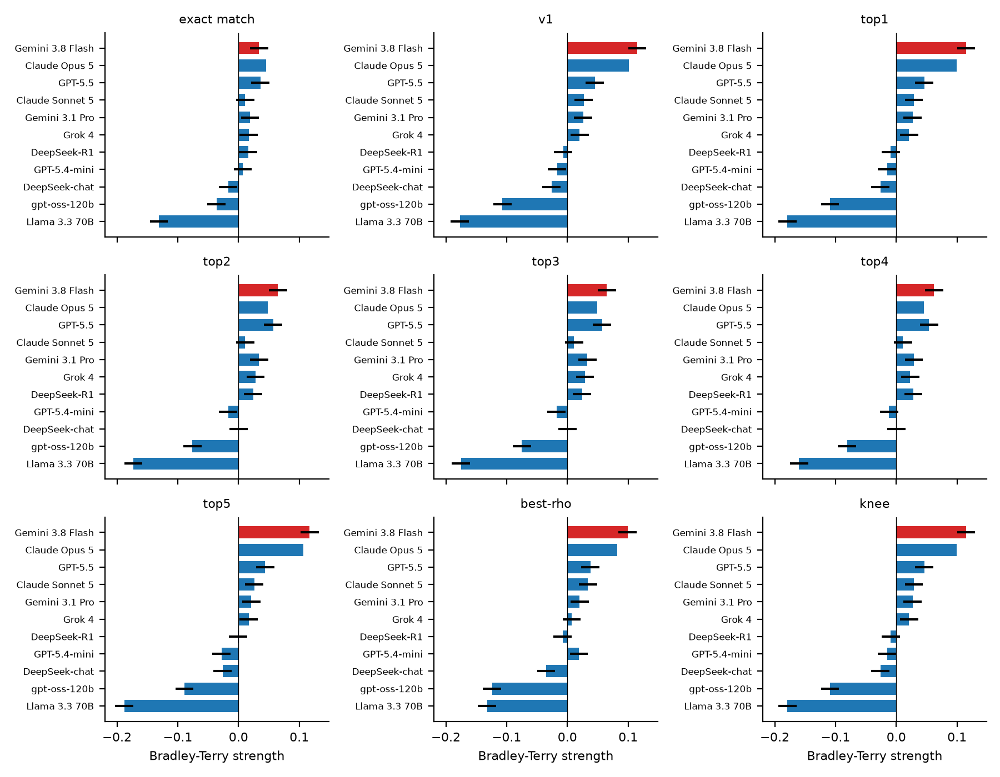

*BT strengths under all nine rules.*

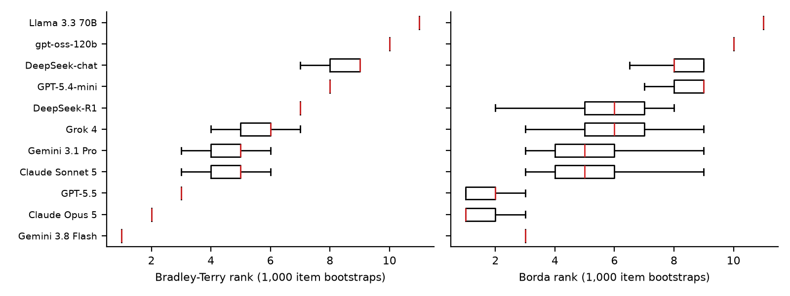

*Bootstrap rank distributions under v1.*

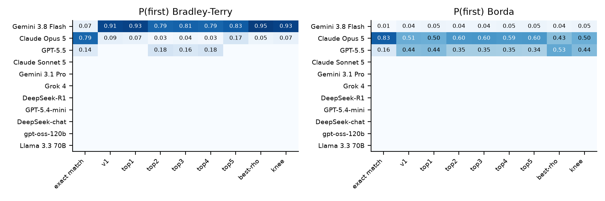

*P(first) by rule and pooling method.*

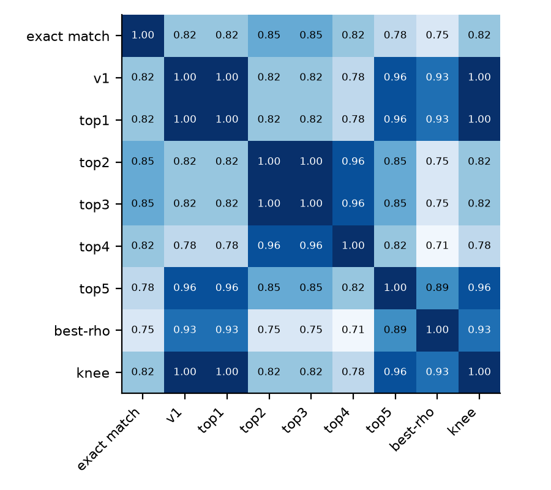

*τ between rules.*

## 10. Significance
Files: `leaderboards/<rule>/significance.json`, `pairwise_item_tests.csv`.
| rule | Friedman χ² | p | Iman–Davenport F | Nemenyi CD | Kendall W | Holm-sig pairs | Nemenyi-sig pairs |
|---|---|---|---|---|---|---|---|
| exact match | 88.1 | 1.27e-14 | 11.9 | 2.71 | 0.267 | 15 | 17 |
| v1 (deployed) | 82.7 | 1.51e-13 | 10.9 | 2.71 | 0.258 | 15 | 17 |
| top1 (best J) | 84.4 | 6.77e-14 | 11.2 | 2.71 | 0.264 | 15 | 16 |
| top2 | 83.5 | 1.03e-13 | 11.1 | 2.71 | 0.259 | 16 | 14 |
| top3 | 83.5 | 1.03e-13 | 11.1 | 2.71 | 0.259 | 16 | 14 |
| top4 | 84.1 | 8.02e-14 | 11.2 | 2.71 | 0.26 | 16 | 16 |
| top5 | 85.4 | 4.34e-14 | 11.4 | 2.71 | 0.267 | 16 | 16 |
| best-rho | 79.2 | 7.16e-13 | 10.3 | 2.71 | 0.247 | 15 | 15 |
| Pareto knee | 84.4 | 6.77e-14 | 11.2 | 2.71 | 0.264 | 15 | 16 |

Mean Friedman rank under v1 (lower is better): Gemini 3.8 Flash 4.52, Claude Opus 5 4.02, GPT-5.5 3.94, Claude Sonnet 5 5.43, Gemini 3.1 Pro 5.63, Grok 4 5.66, DeepSeek-R1 5.61, GPT-5.4-mini 6.84, DeepSeek-chat 6.71, gpt-oss-120b 8.56, Llama 3.3 70B 9.08. Nemenyi CD = 2.71: two models differ at α = .05 only if their mean ranks differ by more than that, which separates the top group from the bottom two and nothing inside the top group.
All 45 cross-dataset pairwise tests under v1 (wins = datasets where a scores higher than b):
| a | b | mean_rank_diff | wins_a | wins_b | ties | wilcoxon_p | wilcoxon_p_holm | nemenyi_significant | wilcoxon_significant_05 |
|---|---|---|---|---|---|---|---|---|---|
| GPT-5.5 | gpt-oss-120b | -4.63 | 27 | 2 | 2 | 8.64e-06 | 0.000475 | yes | yes |
| GPT-5.5 | Llama 3.3 70B | -5.15 | 27 | 4 | 0 | 1.6e-05 | 0.000866 | yes | yes |
| Gemini 3.8 Flash | gpt-oss-120b | -4.05 | 26 | 4 | 1 | 5.64e-05 | 0.00299 | yes | yes |
| GPT-5.4-mini | Llama 3.3 70B | -2.24 | 25 | 4 | 2 | 5.87e-05 | 0.00305 | no | yes |
| gpt-oss-120b | Grok 4 | 2.9 | 5 | 26 | 0 | 7.82e-05 | 0.00399 | yes | yes |
| Gemini 3.8 Flash | Llama 3.3 70B | -4.56 | 26 | 4 | 1 | 8.51e-05 | 0.00425 | yes | yes |
| Claude Sonnet 5 | Llama 3.3 70B | -3.65 | 25 | 4 | 2 | 8.84e-05 | 0.00433 | yes | yes |
| DeepSeek-R1 | Llama 3.3 70B | -3.47 | 23 | 5 | 3 | 0.000108 | 0.0052 | yes | yes |
| Gemini 3.1 Pro | Llama 3.3 70B | -3.45 | 26 | 5 | 0 | 0.000113 | 0.00531 | yes | yes |
| Grok 4 | Llama 3.3 70B | -3.42 | 26 | 4 | 1 | 0.000113 | 0.00531 | yes | yes |
| Claude Opus 5 | Llama 3.3 70B | -5.06 | 25 | 6 | 0 | 0.00022 | 0.00992 | yes | yes |
| Gemini 3.1 Pro | gpt-oss-120b | -2.94 | 23 | 4 | 4 | 0.000322 | 0.0142 | yes | yes |
| Claude Opus 5 | gpt-oss-120b | -4.55 | 26 | 4 | 1 | 0.000335 | 0.0144 | yes | yes |
| DeepSeek-chat | Llama 3.3 70B | -2.37 | 22 | 5 | 4 | 0.000402 | 0.0169 | no | yes |
| DeepSeek-R1 | gpt-oss-120b | -2.95 | 25 | 5 | 1 | 0.000542 | 0.0222 | yes | yes |
| GPT-5.4-mini | GPT-5.5 | 2.9 | 5 | 25 | 1 | 0.00126 | 0.0505 | yes | no |
| DeepSeek-chat | GPT-5.5 | 2.77 | 6 | 21 | 4 | 0.00253 | 0.0988 | yes | no |
| Claude Sonnet 5 | gpt-oss-120b | -3.13 | 21 | 8 | 2 | 0.00409 | 0.155 | yes | no |
| GPT-5.4-mini | gpt-oss-120b | -1.73 | 22 | 9 | 0 | 0.00421 | 0.156 | no | no |
| Claude Opus 5 | GPT-5.4-mini | -2.82 | 25 | 6 | 0 | 0.00476 | 0.172 | yes | no |
| DeepSeek-chat | Gemini 3.8 Flash | 2.19 | 6 | 22 | 3 | 0.00682 | 0.239 | no | no |
| Gemini 3.1 Pro | GPT-5.5 | 1.69 | 6 | 21 | 4 | 0.00861 | 0.293 | no | no |
| Gemini 3.1 Pro | GPT-5.4-mini | -1.21 | 21 | 7 | 3 | 0.0114 | 0.378 | no | no |
| Gemini 3.8 Flash | GPT-5.4-mini | -2.32 | 21 | 9 | 1 | 0.0135 | 0.432 | no | no |
| Claude Opus 5 | DeepSeek-chat | -2.69 | 21 | 8 | 2 | 0.0151 | 0.468 | no | no |
| GPT-5.5 | Grok 4 | -1.73 | 18 | 8 | 5 | 0.0212 | 0.635 | no | no |
| Claude Opus 5 | Claude Sonnet 5 | -1.42 | 22 | 7 | 2 | 0.0275 | 0.797 | no | no |
| Gemini 3.1 Pro | Gemini 3.8 Flash | 1.11 | 7 | 18 | 6 | 0.0333 | 0.933 | no | no |
| DeepSeek-chat | gpt-oss-120b | -1.85 | 20 | 9 | 2 | 0.0351 | 0.948 | no | no |
| Claude Sonnet 5 | GPT-5.5 | 1.5 | 9 | 19 | 3 | 0.0368 | 0.956 | no | no |
| Claude Sonnet 5 | GPT-5.4-mini | -1.4 | 20 | 8 | 3 | 0.0395 | 0.988 | no | no |
| Claude Opus 5 | Gemini 3.1 Pro | -1.61 | 20 | 7 | 4 | 0.0465 | 1 | no | no |
| Claude Sonnet 5 | DeepSeek-chat | -1.27 | 20 | 7 | 4 | 0.0488 | 1 | no | no |
| DeepSeek-R1 | GPT-5.5 | 1.68 | 8 | 19 | 4 | 0.0678 | 1 | no | no |
| Claude Opus 5 | DeepSeek-R1 | -1.6 | 16 | 12 | 3 | 0.081 | 1 | no | no |
| DeepSeek-R1 | Gemini 3.8 Flash | 1.1 | 11 | 18 | 2 | 0.0899 | 1 | no | no |
| Claude Opus 5 | Grok 4 | -1.65 | 18 | 10 | 3 | 0.09 | 1 | no | no |
| Claude Sonnet 5 | Gemini 3.8 Flash | 0.919 | 11 | 17 | 3 | 0.0997 | 1 | no | no |
| Gemini 3.8 Flash | Grok 4 | -1.15 | 17 | 12 | 2 | 0.114 | 1 | no | no |
| gpt-oss-120b | Llama 3.3 70B | -0.516 | 19 | 12 | 0 | 0.117 | 1 | no | no |
| DeepSeek-chat | Gemini 3.1 Pro | 1.08 | 12 | 16 | 3 | 0.152 | 1 | no | no |
| Claude Opus 5 | Gemini 3.8 Flash | -0.5 | 18 | 10 | 3 | 0.199 | 1 | no | no |
| DeepSeek-chat | DeepSeek-R1 | 1.1 | 11 | 19 | 1 | 0.285 | 1 | no | no |
| DeepSeek-chat | Grok 4 | 1.05 | 13 | 15 | 3 | 0.327 | 1 | no | no |
| GPT-5.4-mini | Grok 4 | 1.18 | 12 | 16 | 3 | 0.347 | 1 | no | no |
| DeepSeek-R1 | GPT-5.4-mini | -1.23 | 18 | 12 | 1 | 0.399 | 1 | no | no |
| Claude Opus 5 | GPT-5.5 | 0.0806 | 13 | 11 | 7 | 0.517 | 1 | no | no |
| DeepSeek-R1 | Gemini 3.1 Pro | -0.0161 | 14 | 16 | 1 | 0.563 | 1 | no | no |
| Claude Sonnet 5 | Grok 4 | -0.226 | 18 | 11 | 2 | 0.59 | 1 | no | no |
| DeepSeek-chat | GPT-5.4-mini | -0.129 | 13 | 14 | 4 | 0.624 | 1 | no | no |
| Gemini 3.1 Pro | Grok 4 | -0.0323 | 15 | 14 | 2 | 0.659 | 1 | no | no |
| DeepSeek-R1 | Grok 4 | -0.0484 | 12 | 15 | 4 | 0.724 | 1 | no | no |
| Gemini 3.8 Flash | GPT-5.5 | 0.581 | 14 | 15 | 2 | 0.891 | 1 | no | no |
| Claude Sonnet 5 | Gemini 3.1 Pro | -0.194 | 14 | 15 | 2 | 0.984 | 1 | no | no |
| Claude Sonnet 5 | DeepSeek-R1 | -0.177 | 15 | 14 | 2 | 0.992 | 1 | no | no |

Per-item paired tests (within datasets, Holm within dataset): number of datasets in which each pair is separated:
| a | b | datasets |
|---|---|---|
| Claude Opus 5 | Llama 3.3 70B | 13 |
| Gemini 3.8 Flash | Llama 3.3 70B | 11 |
| DeepSeek-R1 | Llama 3.3 70B | 11 |
| GPT-5.5 | Llama 3.3 70B | 11 |
| Gemini 3.1 Pro | Llama 3.3 70B | 10 |
| Grok 4 | Llama 3.3 70B | 9 |
| DeepSeek-chat | Gemini 3.8 Flash | 8 |
| Claude Opus 5 | gpt-oss-120b | 8 |
| Claude Sonnet 5 | Llama 3.3 70B | 8 |
| gpt-oss-120b | Llama 3.3 70B | 7 |
| Claude Opus 5 | DeepSeek-chat | 7 |
| Claude Opus 5 | Grok 4 | 6 |
| GPT-5.4-mini | Llama 3.3 70B | 6 |
| Gemini 3.8 Flash | gpt-oss-120b | 6 |
| DeepSeek-chat | Llama 3.3 70B | 5 |
| Claude Opus 5 | GPT-5.4-mini | 5 |
| GPT-5.5 | gpt-oss-120b | 5 |
| Claude Opus 5 | DeepSeek-R1 | 4 |
| Gemini 3.1 Pro | gpt-oss-120b | 4 |
| Claude Opus 5 | GPT-5.5 | 4 |

Significant pairs per dataset (of 45):
| dataset | pairs | family |
|---|---|---|
| fetaqa | 33 | TQA |
| officeqa | 26 | FIN |
| bird | 25 | TQA |
| officeqa_pro_v2 | 24 | FIN |
| alaska_camera | 19 | EM |
| opensanctions_pairs | 15 | EM |
| suc | 11 | TQA |
| tablebench | 10 | TQA |
| tabis | 10 | TQA |
| realhitbench | 10 | TQA |
| magneto_gdc | 10 | SM |
| smat | 9 | SM |
| wikitablequestions | 7 | TQA |
| alaska_schema | 6 | SM |
| tableeval | 6 | TQA |
| tab_fact | 4 | TQA |
| tat_qa | 2 | FIN |
| mmtu | 2 | TQA |
| hitab | 1 | TQA |
| dblp_scholar | 0 | EM |
| dblp_acm | 0 | EM |
| fintagging | 0 | SM |
| amazon_google | 0 | EM |
| machamp | 0 | EM |
| papadakis_dn | 0 | EM |
| tpcdi_cells | 0 | SM |
| valentine | 0 | SM |
| walmart_amazon | 0 | EM |
| wdc_lspc | 0 | EM |
| wdc_products | 0 | EM |
| abt_buy | 0 | EM |

12 datasets separate no pair at all at the item level (dblp_scholar, dblp_acm, fintagging, amazon_google, machamp, papadakis_dn, tpcdi_cells, valentine, walmart_amazon, wdc_lspc, wdc_products, abt_buy); 4 separate 20 or more. Power lives in a dozen datasets.
Boolean datasets: exact-match accuracy of the best and worst model against the majority-class baseline of the pool:
| dataset | majority class | best model | worst model | models above baseline |
|---|---|---|---|---|
| abt_buy | 0.510 | 1.000 | 0.940 | 11 |
| alaska_camera | 0.530 | 1.000 | 0.810 | 11 |
| amazon_google | 0.550 | 0.960 | 0.860 | 11 |
| dblp_acm | 0.510 | 1.000 | 0.910 | 11 |
| dblp_scholar | 0.510 | 0.970 | 0.910 | 11 |
| machamp | 0.530 | 0.900 | 0.830 | 11 |
| opensanctions_pairs | 0.510 | 0.970 | 0.730 | 11 |
| papadakis_dn | 0.850 | 0.950 | 0.920 | 11 |
| tab_fact | 0.540 | 0.860 | 0.660 | 11 |
| walmart_amazon | 0.590 | 0.990 | 0.930 | 11 |
| wdc_lspc | 0.540 | 1.000 | 0.960 | 11 |
| wdc_products | 0.540 | 0.990 | 0.970 | 11 |

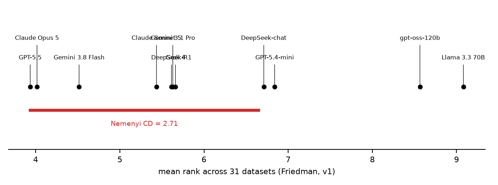

*Critical-difference view under v1.*

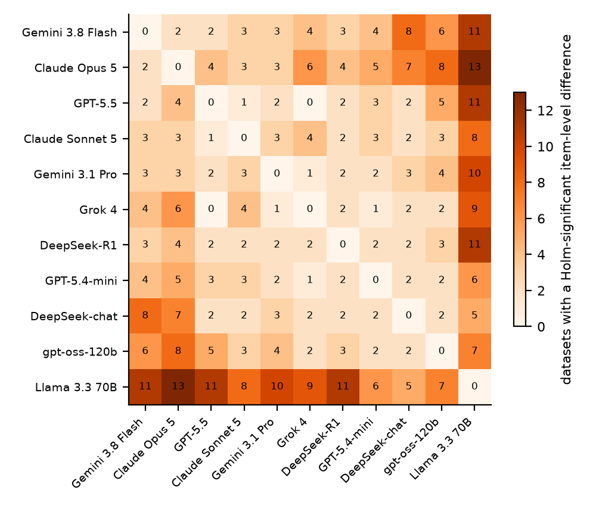

*Item-level significant pairs.*

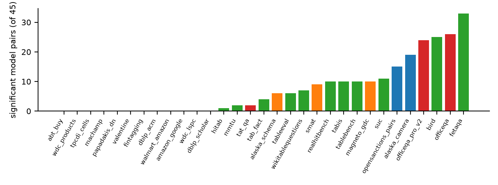

*Significant pairs per dataset.*

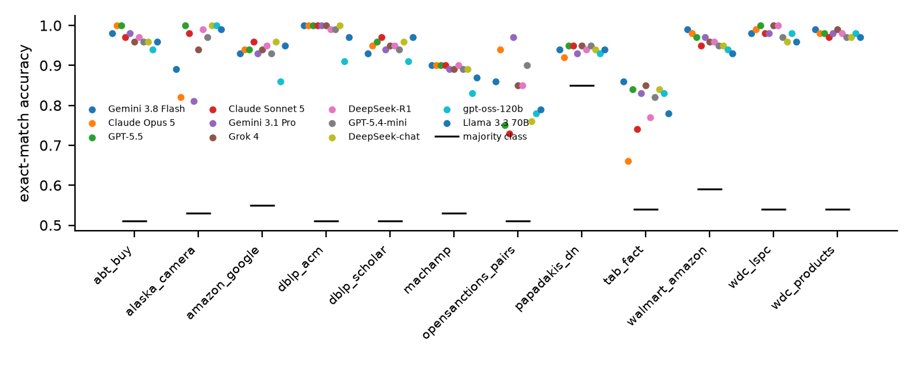

*Boolean sets vs majority baseline.*

## 11. Official-split comparability
File: `leaderboards/v1_original/official_split_estimates.csv` (post-stratification to the official stratum / class proportions, weighted bootstrap).
| dataset | suite | official | lo | hi | eff_n | f1_pool | f1_official | prec_off | rec_off | pos_share | shift | f1 drop |
|---|---|---|---|---|---|---|---|---|---|---|---|---|
| opensanctions_pairs | 0.835 | 0.748 | 0.654 | 0.842 | 76.249 | 0.790 | 0.795 | 0.993 | 0.677 | 0.769 | -0.086 | -0.005 |
| tat_qa | 0.804 | 0.759 | 0.672 | 0.841 | 60.725 | – | – | – | – | – | -0.045 | – |
| mmtu | 0.873 | 0.836 | 0.750 | 0.916 | 86.538 | – | – | – | – | – | -0.037 | – |
| tab_fact | 0.802 | 0.792 | 0.710 | 0.872 | 99.360 | 0.761 | 0.767 | 0.903 | 0.674 | 0.500 | -0.009 | -0.006 |
| valentine | 0.985 | 0.981 | 0.957 | 0.999 | 81.736 | – | – | – | – | – | -0.004 | – |
| amazon_google | 0.935 | 0.932 | 0.864 | 0.984 | 67.152 | 0.928 | 0.738 | 0.609 | 0.941 | 0.102 | -0.004 | 0.190 |
| suc | 0.917 | 0.915 | 0.867 | 0.955 | 98.920 | – | – | – | – | – | -0.003 | – |
| tablebench | 0.822 | 0.820 | 0.748 | 0.886 | 89.187 | – | – | – | – | – | -0.002 | – |
| smat | 0.915 | 0.913 | 0.865 | 0.954 | 98.100 | – | – | – | – | – | -0.002 | – |
| wikitablequestions | 0.847 | 0.845 | 0.778 | 0.906 | 97.686 | – | – | – | – | – | -0.002 | – |
| fintagging | 0.883 | 0.882 | 0.814 | 0.942 | 51.769 | – | – | – | – | – | -0.002 | – |
| realhitbench | 0.675 | 0.675 | 0.593 | 0.756 | 98.080 | – | – | – | – | – | -0.001 | – |
| officeqa | 0.130 | 0.130 | 0.097 | 0.168 | 100.000 | – | – | – | – | – | 0.000 | – |
| officeqa_pro_v2 | 0.142 | 0.142 | 0.102 | 0.187 | 90.000 | – | – | – | – | – | 0.000 | – |
| alaska_camera | 0.945 | 0.945 | 0.910 | 0.973 | 100.000 | 0.939 | 0.939 | 1.000 | 0.895 | 0.500 | 0.000 | 0.000 |
| fetaqa | 0.387 | 0.387 | 0.361 | 0.412 | 100.000 | – | – | – | – | – | 0.000 | – |
| alaska_schema | 0.929 | 0.929 | 0.882 | 0.969 | 93.000 | – | – | – | – | – | 0.000 | – |
| wdc_lspc | 0.982 | 0.984 | 0.965 | 0.999 | 75.082 | 0.983 | 0.972 | 0.968 | 0.978 | 0.264 | 0.002 | 0.011 |
| magneto_gdc | 0.937 | 0.940 | 0.902 | 0.972 | 93.027 | – | – | – | – | – | 0.003 | – |
| tableeval | 0.755 | 0.758 | 0.659 | 0.850 | 69.689 | – | – | – | – | – | 0.003 | – |
| hitab | 0.772 | 0.775 | 0.695 | 0.848 | 94.537 | – | – | – | – | – | 0.003 | – |
| machamp | 0.887 | 0.891 | 0.803 | 0.959 | 32.491 | 0.892 | 0.735 | 0.649 | 0.852 | 0.175 | 0.004 | 0.156 |
| dblp_acm | 0.987 | 0.992 | 0.983 | 0.999 | 72.166 | 0.986 | 0.978 | 0.981 | 0.980 | 0.180 | 0.005 | 0.008 |
| tabis | 0.918 | 0.923 | 0.872 | 0.964 | 77.069 | – | – | – | – | – | 0.005 | – |
| tpcdi_cells | 0.456 | 0.462 | 0.373 | 0.550 | 95.091 | – | – | – | – | – | 0.005 | – |
| wdc_products | 0.978 | 0.986 | 0.962 | 1.000 | 77.046 | 0.979 | 0.975 | 0.982 | 0.968 | 0.280 | 0.008 | 0.005 |
| walmart_amazon | 0.959 | 0.974 | 0.937 | 0.998 | 70.807 | 0.949 | 0.872 | 0.824 | 0.931 | 0.094 | 0.015 | 0.076 |
| abt_buy | 0.971 | 0.987 | 0.964 | 0.999 | 63.075 | 0.969 | 0.940 | 0.933 | 0.950 | 0.108 | 0.016 | 0.030 |
| dblp_scholar | 0.948 | 0.966 | 0.923 | 0.995 | 70.463 | 0.947 | 0.909 | 0.901 | 0.922 | 0.186 | 0.018 | 0.038 |
| bird | 0.190 | 0.218 | 0.140 | 0.304 | 74.082 | – | – | – | – | – | 0.028 | – |
| papadakis_dn | 0.940 | 0.987 | 0.967 | 0.998 | 32.601 | 0.831 | 0.662 | 0.527 | 0.967 | 0.018 | 0.047 | 0.169 |

* Accuracy shifts by at most 0.086 (opensanctions_pairs); for 23 datasets the shift is under 0.01 because the pool strata already match the official split or there is no census (n/c rows are excluded from the mean).
* For the matching sets the balanced pool overstates positive-class F1 wherever the official match share is small: the drop is 0.19 on amazon_google (official match share 0.102) and 0.17 on Papadakis–Christen (share 0.018), driven by precision: at a 2 % match rate even a 1 % false-positive rate halves precision.
* Effective sample size after re-weighting falls to 32 on machamp: the official-ratio intervals for the sparse matching sets are wide, and the official estimates should be read with their intervals.

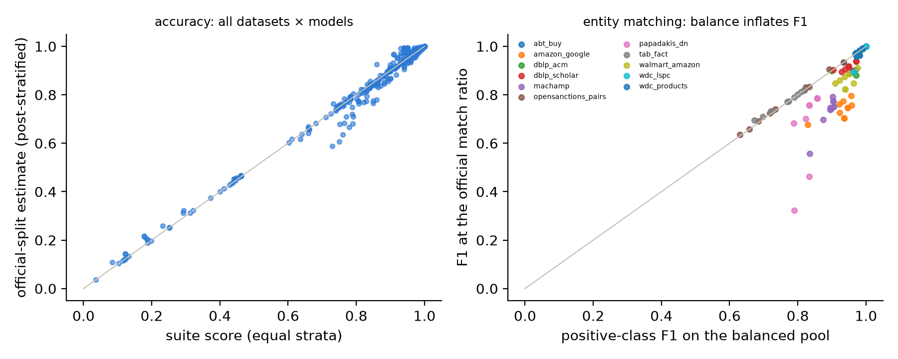

*Suite vs official estimates.*

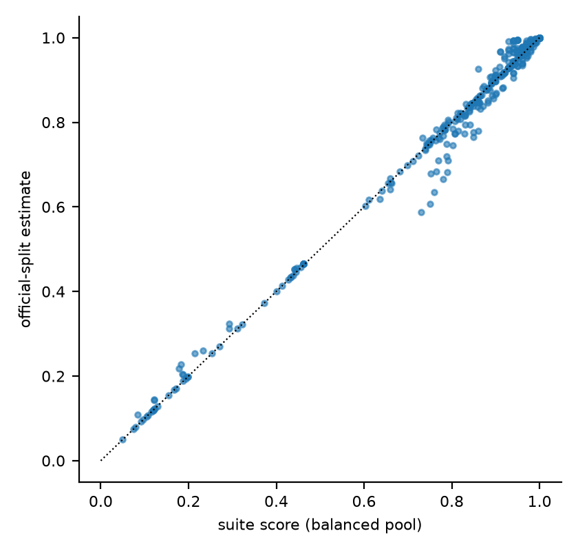

*All (dataset, model) pairs.*

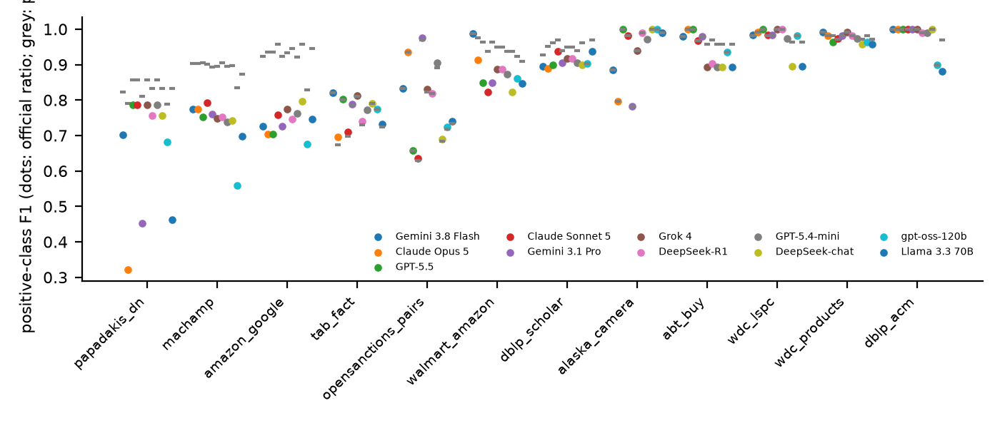

*Matching F1: pool vs official ratio per model.*

## 12. Dataset diagnostics
Files: `diagnostics/dataset_diagnostics.csv`, `diagnostics.json` (pairwise τ between dataset rankings).
| dataset | family | mean_score | spread_across_models | floor | ceiling | share_constant_bootstrap_rankings | ranking_self_stability_tau | tau_to_others_mean | n_items | exclude_from_objective |
|---|---|---|---|---|---|---|---|---|---|---|
| officeqa | FIN | 0.130 | 0.124 | no | no | 0.000 | 0.862 | 0.291 | 100 | no |
| officeqa_pro_v2 | FIN | 0.142 | 0.220 | no | no | 0.000 | 0.782 | 0.273 | 90 | no |
| bird | TQA | 0.190 | 0.209 | no | no | 0.000 | 0.828 | 0.305 | 100 | no |
| fetaqa | TQA | 0.387 | 0.192 | no | no | 0.000 | 0.906 | 0.260 | 100 | no |
| tpcdi_cells | SM | 0.456 | 0.020 | no | no | 0.000 | 0.779 | 0.308 | 100 | no |
| realhitbench | TQA | 0.675 | 0.143 | no | no | 0.000 | 0.783 | 0.331 | 100 | no |
| tableeval | TQA | 0.755 | 0.166 | no | no | 0.000 | 0.742 | 0.174 | 100 | no |
| hitab | TQA | 0.772 | 0.068 | no | no | 0.000 | 0.575 | -0.184 | 100 | no |
| tab_fact | TQA | 0.802 | 0.200 | no | no | 0.000 | 0.827 | 0.019 | 100 | no |
| tat_qa | FIN | 0.804 | 0.109 | no | no | 0.000 | 0.762 | 0.254 | 100 | no |
| tablebench | TQA | 0.822 | 0.218 | no | no | 0.000 | 0.663 | 0.220 | 100 | no |
| opensanctions_pairs | EM | 0.835 | 0.240 | no | no | 0.000 | 0.905 | 0.039 | 100 | no |
| wikitablequestions | TQA | 0.847 | 0.132 | no | no | 0.000 | 0.729 | 0.347 | 100 | no |
| mmtu | TQA | 0.873 | 0.110 | no | no | 0.000 | 0.768 | 0.282 | 100 | no |
| fintagging | SM | 0.883 | 0.051 | no | no | 0.000 | 0.649 | 0.291 | 100 | no |
| machamp | EM | 0.887 | 0.070 | no | no | 0.000 | 0.584 | 0.374 | 100 | no |
| smat | SM | 0.915 | 0.150 | no | no | 0.000 | 0.707 | 0.184 | 100 | no |
| suc | TQA | 0.917 | 0.246 | no | no | 0.000 | 0.818 | 0.285 | 100 | no |
| tabis | TQA | 0.918 | 0.210 | no | no | 0.000 | 0.836 | 0.253 | 100 | no |
| alaska_schema | SM | 0.929 | 0.118 | no | no | 0.000 | 0.676 | -0.028 | 93 | no |
| amazon_google | EM | 0.935 | 0.100 | no | no | 0.000 | 0.683 | 0.005 | 100 | no |
| magneto_gdc | SM | 0.937 | 0.225 | no | no | 0.000 | 0.684 | 0.245 | 100 | no |
| papadakis_dn | EM | 0.940 | 0.030 | no | no | 0.002 | 0.741 | 0.030 | 100 | no |
| alaska_camera | EM | 0.945 | 0.190 | no | no | 0.000 | 0.924 | -0.204 | 100 | no |
| dblp_scholar | EM | 0.948 | 0.060 | no | no | 0.000 | 0.713 | -0.016 | 100 | no |
| walmart_amazon | EM | 0.959 | 0.060 | no | no | 0.000 | 0.761 | 0.351 | 100 | no |
| abt_buy | EM | 0.971 | 0.060 | no | no | 0.000 | 0.748 | 0.352 | 100 | no |
| wdc_products | EM | 0.978 | 0.020 | no | yes | 0.006 | 0.623 | 0.188 | 100 | yes |
| wdc_lspc | EM | 0.982 | 0.040 | no | yes | 0.004 | 0.788 | 0.264 | 100 | yes |
| valentine | SM | 0.985 | 0.030 | no | yes | 0.000 | 0.722 | 0.227 | 100 | yes |
| dblp_acm | EM | 0.987 | 0.090 | no | no | 0.000 | 0.883 | 0.331 | 100 | no |

* Pairwise τ between dataset rankings: mean +0.20, median +0.20, range -0.70 to +0.91; 73 % of pairs agree in sign.
Most and least agreeing dataset pairs:
| τ | dataset A | dataset B |
|---|---|---|
| 0.910 | tabis | wdc_lspc |
| 0.831 | tableeval | wdc_products |
| 0.818 | fintagging | officeqa |
| 0.813 | amazon_google | dblp_scholar |
| 0.801 | walmart_amazon | wikitablequestions |
| 0.799 | bird | machamp |
| -0.491 | hitab | wikitablequestions |
| -0.495 | alaska_camera | suc |
| -0.548 | alaska_camera | officeqa |
| -0.673 | hitab | tableeval |
| -0.686 | alaska_camera | opensanctions_pairs |
| -0.700 | hitab | wdc_products |

* Flags: ceiling valentine, wdc_lspc, wdc_products (mean ≥ 0.95, spread ≤ 0.04); floor none; lowest self-stability hitab (0.57), highest alaska_camera (0.92). The three ceiling sets are flagged `exclude_from_objective` but were kept inside J in this run.

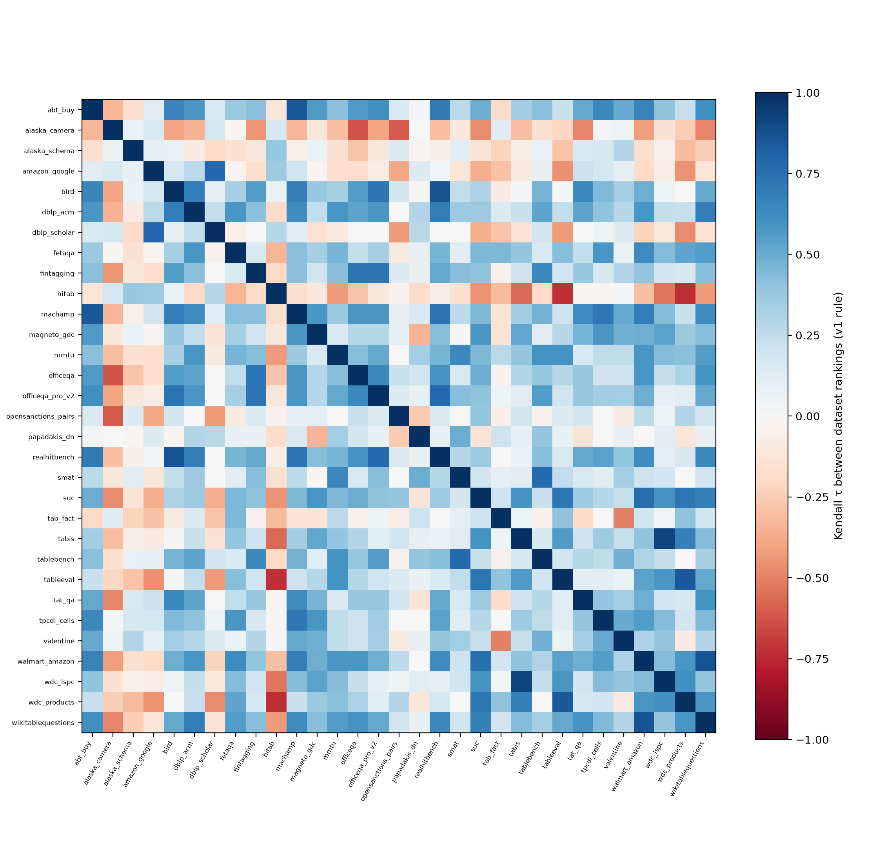

*τ between dataset rankings.*

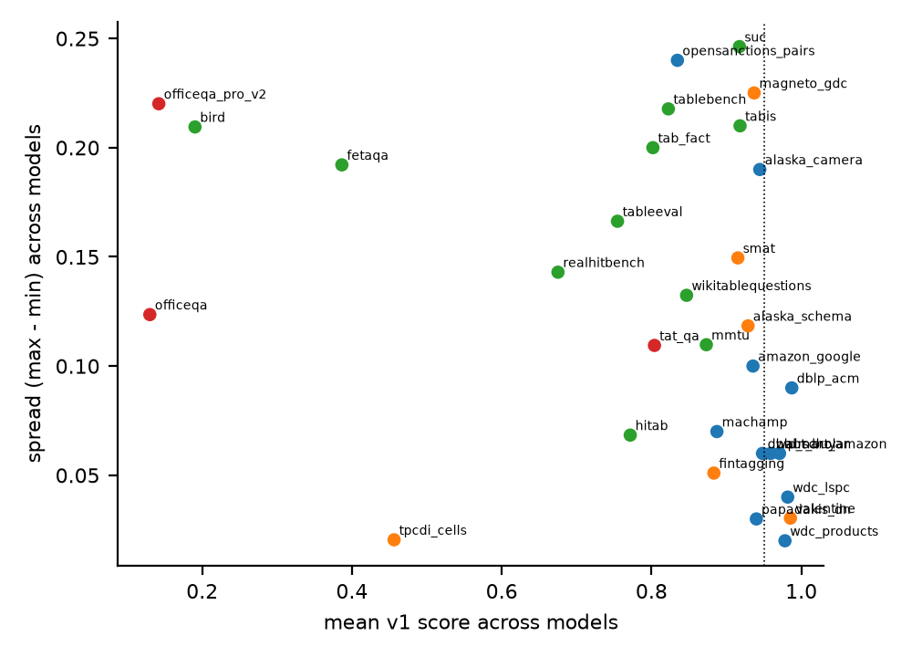

*Mean vs spread.*

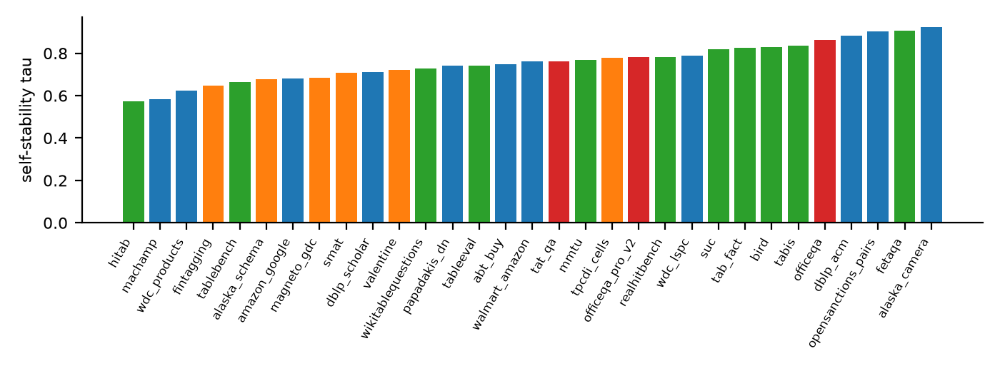

*Self-stability per dataset.*

## 13. What the data support, in one page
1. **The weights of the deployed judge cannot be improved on this suite by the agreement criterion.** All 1,771 weightings span J 0.376–0.414; 1749 are statistically equivalent to the best; the in-sample winner loses 0.047 out of sample and ends -0.007 from v1 with a 95 % interval [-0.033, +0.011]; 624 different weightings win across resamples.
2. **Why it is flat.** The four ingredients agree with each other (F1–recall ρ 0.98, decay–exact match 0.98); in 83 % of answers all four equal exact match; and the families pull in opposite directions (decay for SM, recall for TQA, precision for FIN), cancelling at suite level.
3. **Agreement is not correctness.** On 31,380 anchors v1 scores ρ 0.878, the best-by-J weighting 0.876, the best-by-ρ 0.883, exact match 0.828; Spearman(J, ρ) = -0.23. Every weighting has AUC ≥ 0.989; they differ only in partial credit, and the operators where lexical rules fail (typos, digit typos, medium near misses, shuffled lists) are the ones human labels must settle.
4. **The leaderboard.** Ends fixed under every rule: Llama 3.3 70B last, gpt-oss-120b ninth, Holm-significant against the top group; Friedman p < 0.001 everywhere. First place is Gemini 3.8 Flash by Bradley–Terry (P = 0.91) but GPT-5.5 by Borda under v1, and Claude Opus 5 under exact match. No model is first on more than 6 datasets; Kendall's W = 0.26; 12 datasets separate no pair at the item level.
5. **Comparability.** Post-stratification moves accuracy by ≤ 0.09; balanced matching pools overstate official-ratio F1 by up to 0.19, through precision at low match rates.
6. **Caveats carried by the data.** Lexical scoring only; synthetic anchors; defaults rather than greedy decoding on two providers; 41 answers still cut at 16,000 tokens plus 123 awaiting their 16,000-token re-ask; three ceiling datasets inside the objective; one prompt.
