# Paper figures (v2)

Generated by `paper/scripts/make_paper_figures.py` from `v2_gridsearch/output/`. Each figure exists as PDF (vector, for LaTeX) and PNG (300 dpi). Widths: single column 3.4 in, double column 7.0 in.

Palette: one accent (blue) for the thing to look at, orange for the deployed rule or the highlighted point, greys for context; the four task families use a colour-blind-validated categorical set (blue, orange, aqua, yellow) only where family is the encoding.

## fig01_landscape

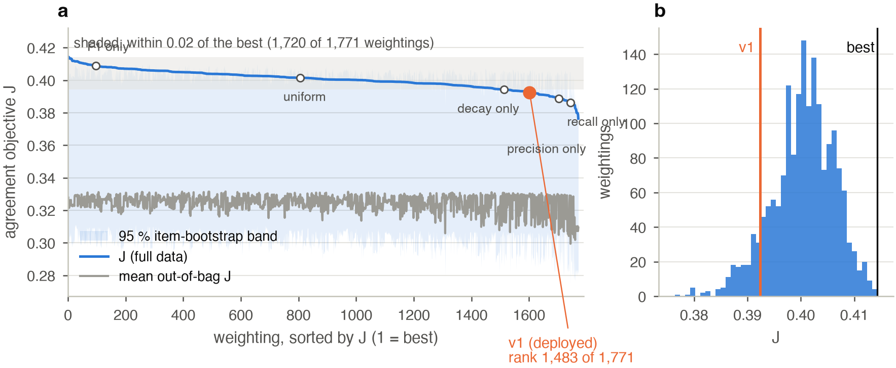

**Caption.** The agreement objective over every weighting of the four ingredients. (a) All 1,771 step-0.05 weightings sorted by J, with the 95 % item-bootstrap band and the mean out-of-bag J; the deployed weights (v1) and the single-ingredient corners are marked. (b) The distribution of J: the whole lattice spans 0.39–0.42, less than the bootstrap width of any single point.

**Suggested placement.** Fig. 1, Results §1 (double column)

## fig02_marginals

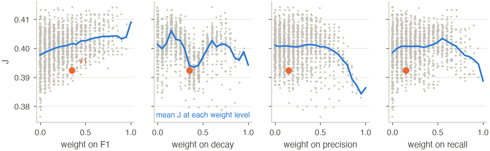

**Caption.** J against each ingredient's weight over the full lattice (grey) with the mean at each weight level (blue). No weight has a slope worth acting on: the largest whole-range swing of the mean is 0.018 (precision).

**Suggested placement.** Fig. 2 or appendix (double column)

## fig03_honest_selection

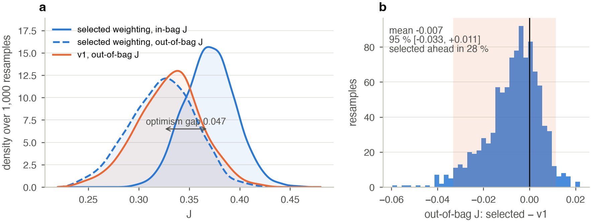

**Caption.** Honest selection with a nested item bootstrap (B = 1,000). (a) The weighting chosen on in-bag items looks better than it is: its out-of-bag J falls below v1's. (b) The paired out-of-bag difference to v1 is centred near zero, with 95 % interval through zero.

**Suggested placement.** Fig. 3, Results §2 (double column)

## fig04_selected_weights

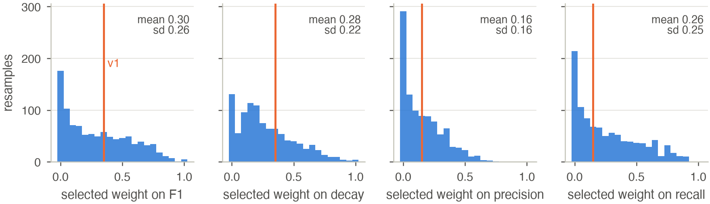

**Caption.** Which weighting wins depends on which items are drawn: the in-bag best over 1,000 resamples spreads over the whole simplex (608 distinct winners); orange = the deployed value.

**Suggested placement.** Fig. 3 companion or appendix (double column)

## fig05_agreement_vs_correctness

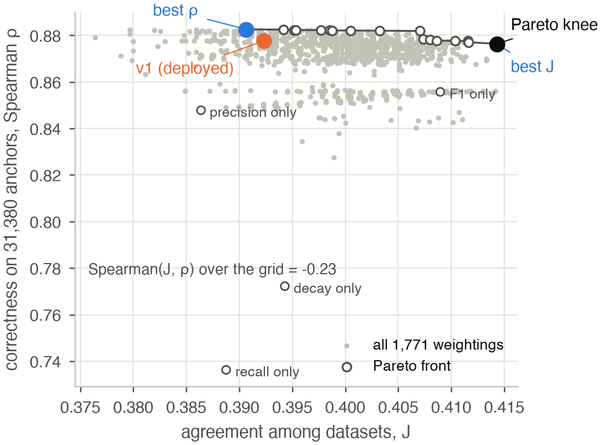

**Caption.** Agreement is not correctness. Every weighting placed by its agreement objective J and its Spearman ρ against the known utility of 31,380 synthetic answers; the two criteria anti-correlate, the best-J weighting is among the worst by ρ, and the deployed v1 sits near the ρ optimum.

**Suggested placement.** Fig. 4, Results §3 (single column)

## fig06_anchor_operators

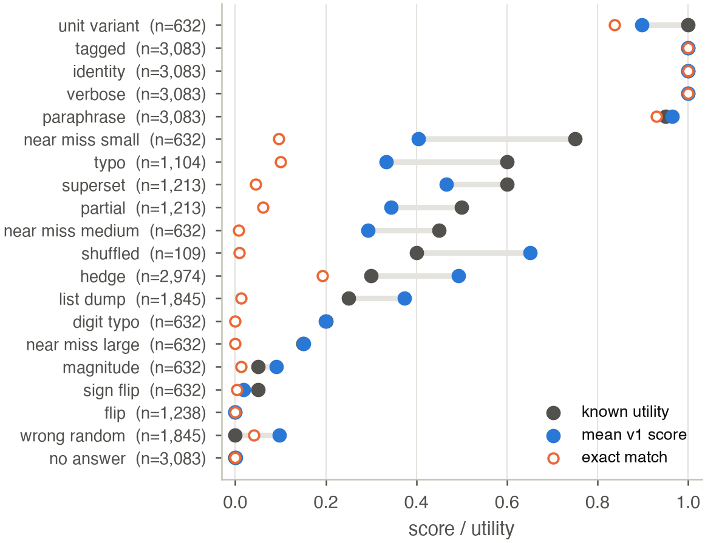

**Caption.** What the judge rewards. Each row is one perturbation operator applied to the gold answers (n anchors); the grey point is its known utility, blue the mean score under the deployed rule, orange exact match. The lexical rule is generous to superset and shuffled lists and severe on typos and medium near misses; these are the cases human labels must settle.

**Suggested placement.** Fig. 5, Results §3 (single column)

## fig07_leaderboard_rules

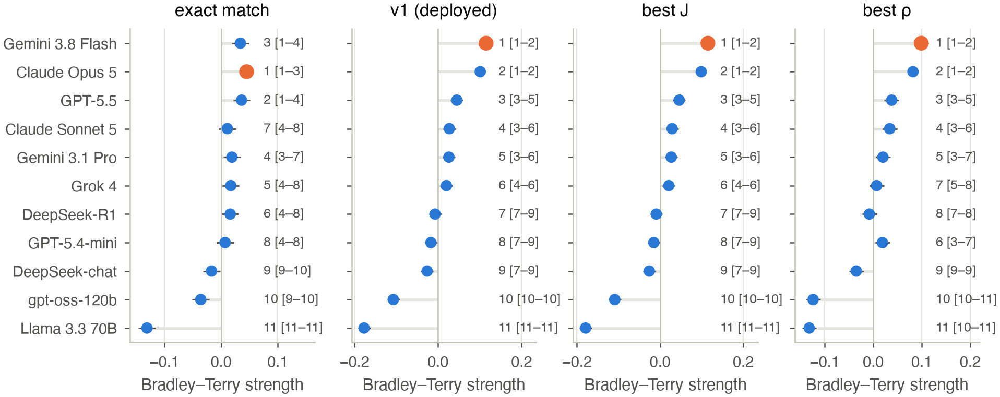

**Caption.** The leaderboard under four scoring rules, pooled by Bradley–Terry over item-level wins (± SE vs reference); orange = first place; the text gives the rank with its 95 % bootstrap interval. The ends are fixed under every rule; the order of the top three depends on the rule.

**Suggested placement.** Fig. 6, Results §4 (double column)

## fig08_rank_matrix

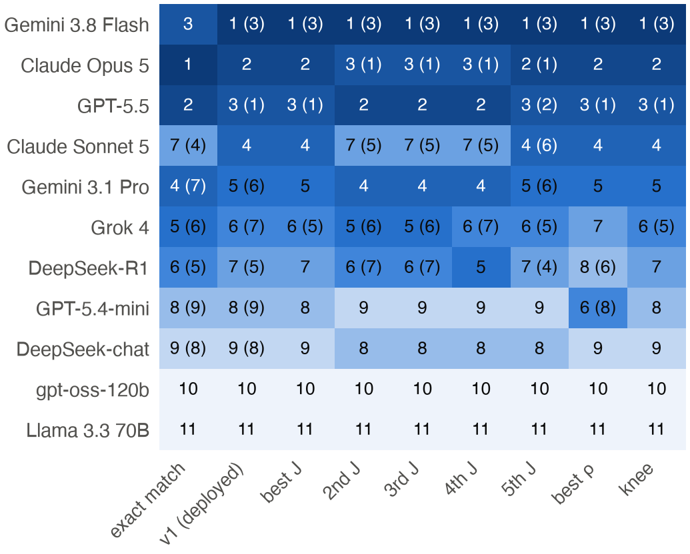

**Caption.** Bradley–Terry rank of every model under every reported rule (Borda rank in brackets where it differs). Dark = better. Rows 4–10 barely move; rows 1–3 swap with the rule.

**Suggested placement.** Fig. 6 companion or appendix (single column)

## fig09_dataset_agreement

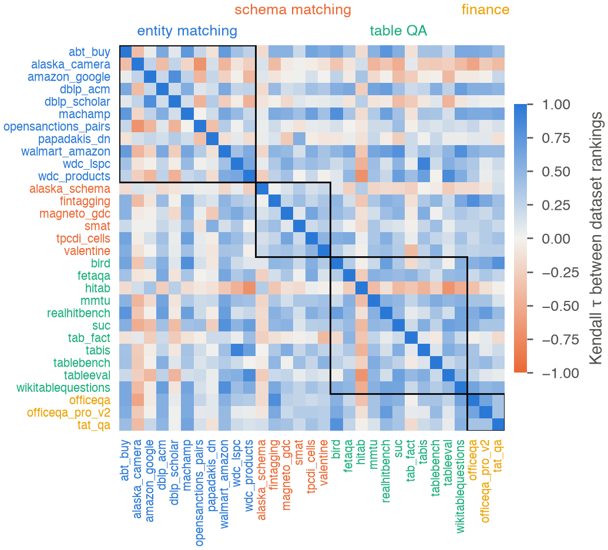

**Caption.** How much the 31 datasets agree about the model ranking under v1: Kendall τ between every pair, grouped by family (boxes). Agreement is moderate inside families and weak across them (Kendall's W = 0.26).

**Suggested placement.** Fig. 7, Results §4 (single column)

## fig10_leave_one_dataset_out

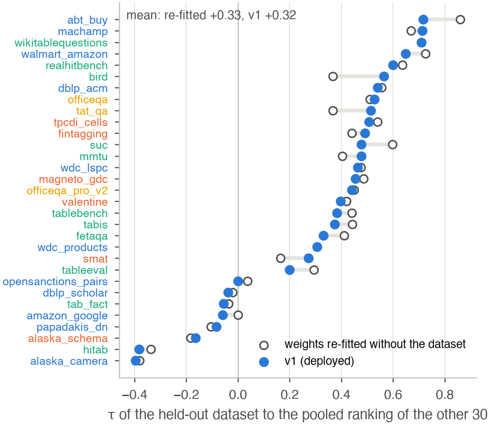

**Caption.** Transfer. For each dataset held out, how well the other 30 predict its ranking under weights re-fitted without it (hollow) and under the deployed weights (blue); label colour = family. Re-fitting does not help, and the same handful of sets resist prediction under any weights.

**Suggested placement.** Fig. 8, Results §5 (single column)

## fig11_family_weights

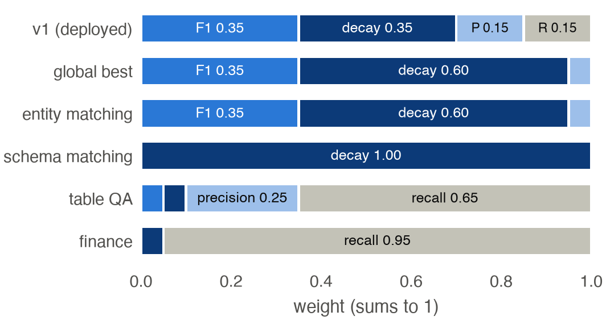

**Caption.** Where the weight goes: the deployed rule, the global optimum, and the optimum fitted inside each task family. Families pull in different directions (decay for schema matching, recall for table QA, precision for finance), which is part of why the suite-level objective is flat.

**Suggested placement.** Fig. 9, Results §5 (single column)

## fig12_official_split_f1

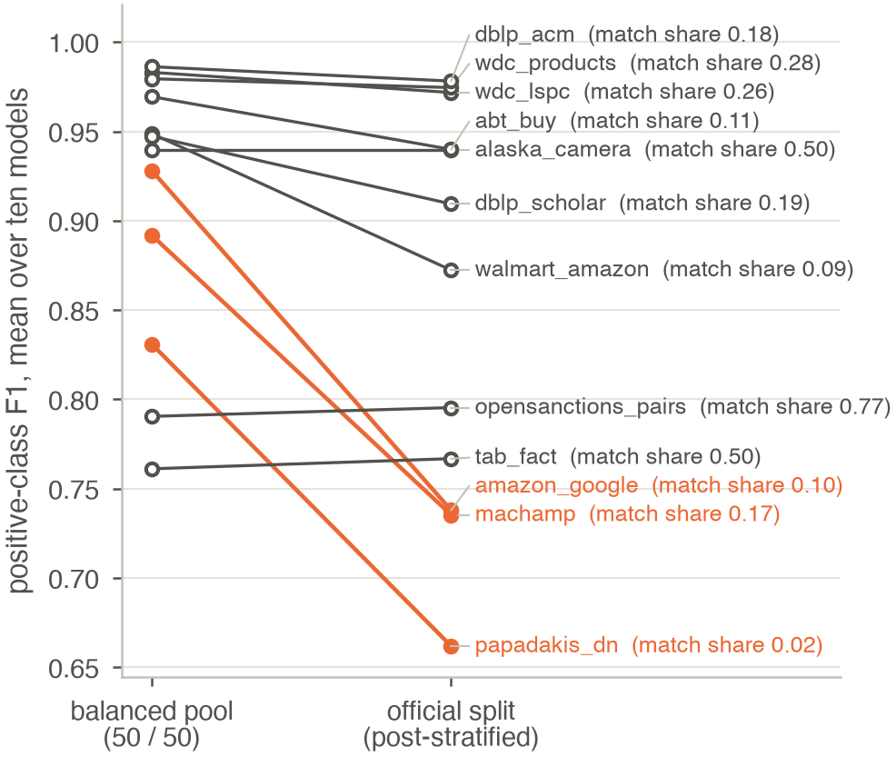

**Caption.** Comparability. Positive-class F1 on the balanced 50/50 pools against the same answers re-weighted to each matching dataset's official match ratio. Where matches are rare the balanced number overstates F1, mainly through precision (orange: drop > 0.10).

**Suggested placement.** Fig. 10, Results §6 (single column)

## fig13_critical_difference

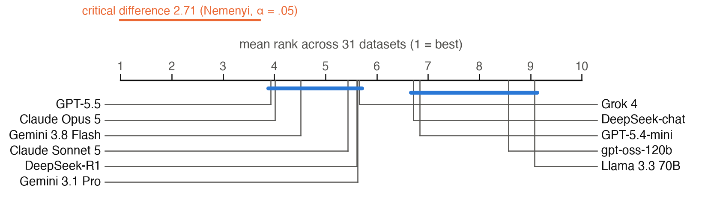

**Caption.** Friedman test under v1 (p < 0.001) with the Nemenyi critical difference: models joined by a blue bar are not separated at α = .05. The top group is separated from the bottom two; nothing inside the top group is.

**Suggested placement.** Fig. 6 companion or appendix (double column)

## fig14_why_flat

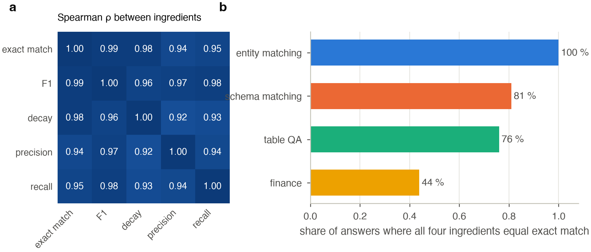

**Caption.** Why the weights barely matter. (a) The four ingredients agree with each other almost everywhere. (b) In most answers all four equal exact match, so every weighting gives the same score; only the table-QA and finance answers leave room for the weights to act.

**Suggested placement.** Fig. 2 alternative, Results §1 (double column)

## fig15_cost_vs_strength

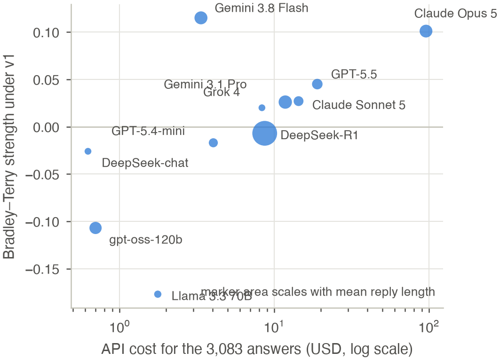

**Caption.** What the ranking costs. Bradley–Terry strength under the deployed rule against the API cost of answering the suite; marker size is mean reply length. The top three span a 30× price range.

**Suggested placement.** Discussion or appendix (single column)

## fig16_power_per_dataset

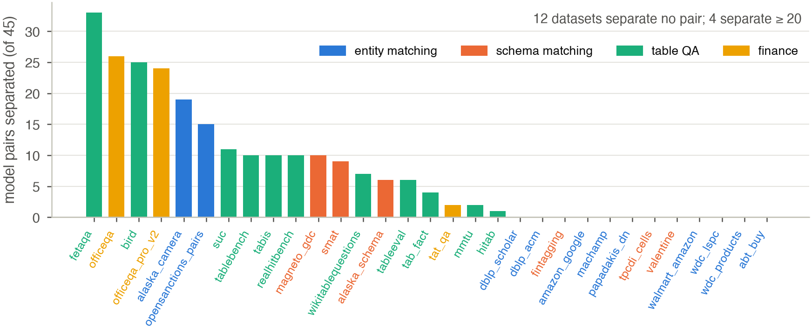

**Caption.** Where the leaderboard's power comes from: the number of model pairs each dataset separates with a Holm-corrected per-item paired test under v1. The entity-matching sets at ceiling separate none; a dozen table and document sets carry the result.

**Suggested placement.** Fig. 7 companion or appendix (double column)
